<h1>EdgeX Foundry Software Deployment</h1>

[1. Hardware](#1-hardware)<br>
[2. Prerequisites](#2-prerequisites)<br>
[3. Deploy EdgeX Foundry](#3-deploy-edgex-foundry)<br>
[4. Configure the Serial Server](#4-configure-the-serial-server)<br>
[5. Integrate the OWON Gateway](#5-integrate-the-owon-gateway)<br>
[6. Integrate the ZhongHong Modbus Gateway](#6-integrate-the-zhonghong-modbus-gateway)<br>
[7. Integrate the Android Music Box](#7-integrate-the-android-music-box)<br>
[8. Troubleshooting](#8-troubleshooting)<br>

In an IoT architecture, EdgeX Foundry provides a secure and efficient way to connect intelligent edge devices. This guide describes the required hardware, prerequisites, deployment steps, and post-deployment configuration.

## 1. Hardware
| Device | Specification/Model |
| --- | --- |
| EdgeX Foundry server<br>(Intel edge device) | 8 GB RAM; Intel(R) Core(TM) i7-7700HQ CPU @ 2.80 GHz <br> OS: Ubuntu 16.04 |
| ZhongHong Modbus gateway | B17X2RT |
| RS485 serial server | ZX-S508D (Modbus TCP supported) |
| OWON gateway | SEG-X1 |
| Smart ZigBee lighting group | FNB56-ZCW39GD1.1 |
| RF remote switch | SLC600_R3 |
| Smart lighting panel | SLC600-L3 |
| DIN-rail relay | CB432 |
| Android music box | audio_2021309_Rk3288 |

## 2. Prerequisites
Before deployment, make sure that:
- The hardware is installed as shown below.<br>
  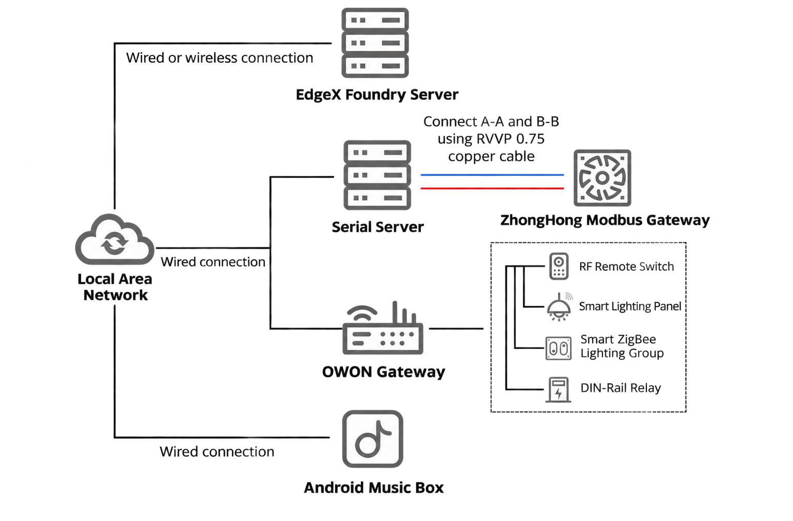<br>
- The following software is installed on the EdgeX Foundry server:

  | Package | Minimum version |
  | --- | --- |
  | docker | 18.09.7 or later |
  | docker-compose | 1.29.1 or later |

- You have the following configuration files:

  | File | Description |
  | --- | --- |
  | docker-compose.yml | Docker configuration |
  | edgex_metric_profile.yaml | EdgeX Foundry host information |
  | owon_lamp_profile.yaml | Smart ZigBee lighting group |
  | owon_smartplug_1_profile | DIN-rail relay |
  | owon_smartplug_2_profile | Smart lighting panel |
  | zhonghong_modbus_profile.yaml | ZhongHong Modbus gateway |
  | suntop_android_mqtt_profile.yaml | Android music box |

Contact Hydsoft technical support if you encounter problems.

## 3. Deploy EdgeX Foundry
1. Sign in to the EdgeX Foundry server as `root`.
2. Change to `/root`:<br>`cd /root`<br>
3. Use WinSCP to place `docker-compose.yml` in `/root`.
4. Start EdgeX Foundry:<br>`docker-compose up -d`<br>
5. Check whether the services started successfully:<br>`docker-compose ps`<br>
   - If all containers are `up`, EdgeX Foundry has started successfully.<br>
     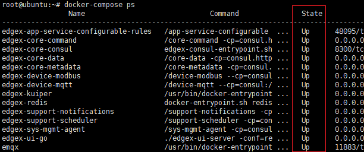<br>
   - If any container is in the `Exit` state, try starting it using the `docker start` command.<br>
     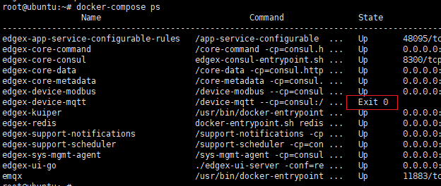<br>

If the service still fails to start, inspect the logs with `docker logs` and send them to Hydsoft technical support for analysis.

## 4. Configure the Serial Server
1. In a browser, open `http://{serial server IP address}/cgi-bin/luci`.
2. Sign in to the serial server web interface with your username and password.
3. Configure the server port as shown below. This example uses `PORT 8` and local port `4008`.<br>
   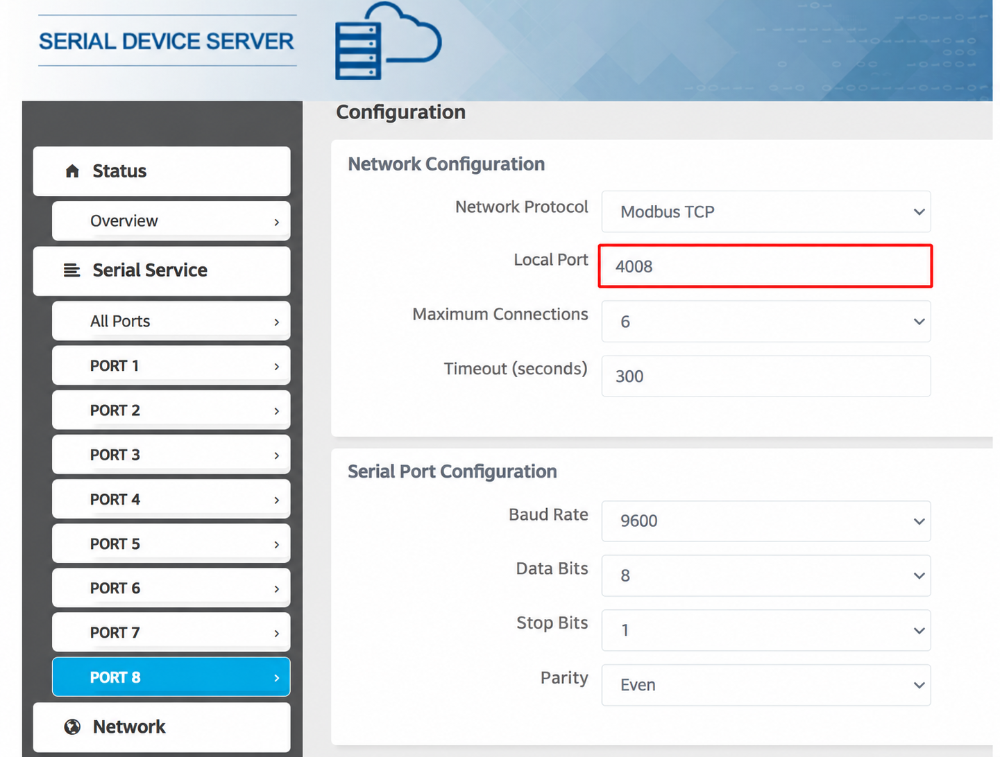

## 5. Integrate the OWON Gateway
1. Add the devices connected to the OWON gateway.<br>
   (1) Open `http://{EdgeX Foundry server IP address}:4000/` in a browser and sign in. When you sign in for the first time, create a username and password.<br>
   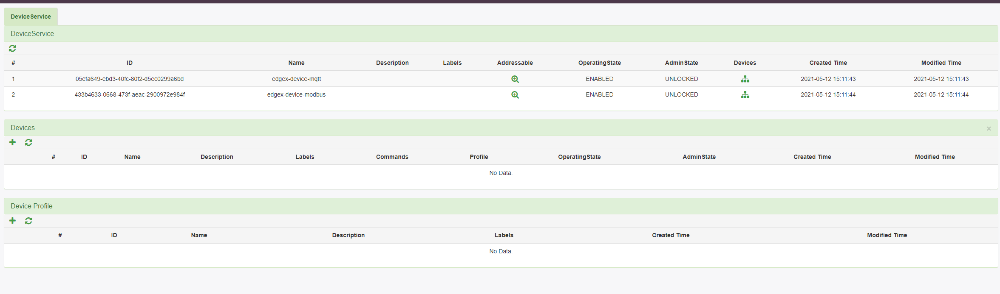<br>
   (2) In **DeviceService**, click the icon in the **Devices** column for the OWON gateway container.<br>
   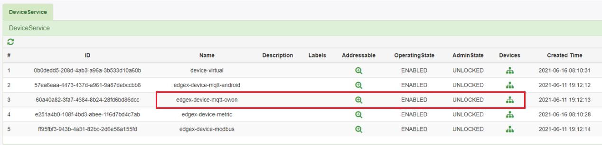<br>
   (3) First, configure the default OWON gateway device, which is used to retrieve the list of gateway devices. On the **Devices** page, click the edit icon. In the **Add or Update Device** page, enter the details and replace the placeholder with `api/device/{deviceId}/{appclientId}`. Here `{deviceId}` is the OWON gateway MAC address, and `{appclientId}` is a custom identifier.<br>
   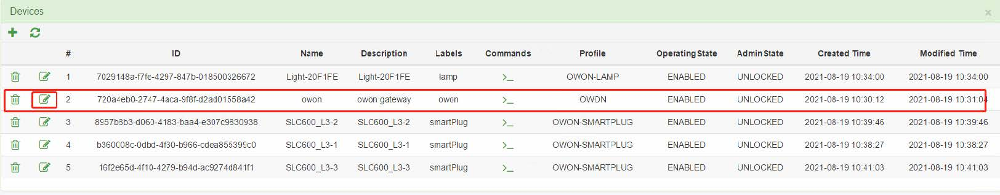<br>
   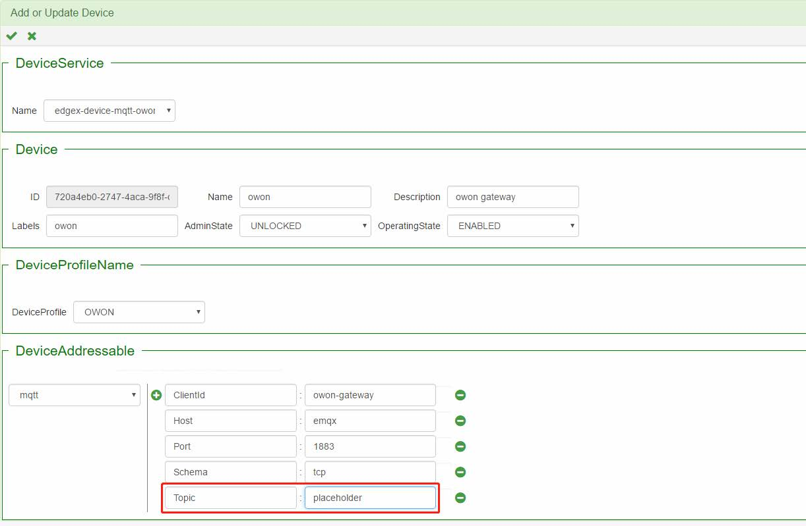<br>
   (4) Return to the **Devices** page and click the plus sign to add each connected device. Set the **Name** and **Description** fields as desired. Set **Labels** to one of the following device types:
   - `lamp`: smart ZigBee lighting group
   - `smartSwitch`: smart lighting panel
   - `smartPlug`: DIN-rail relay
   
   (5) Select the profile in the **DeviceProfileName** field. See the list of configuration files in [Prerequisites](#2-prerequisites).

   (6) Under **DeviceAddressable**, click the plus icon to add fields and enter the device details:
   - **Clientid**: `clientid`
   - **Host**: EdgeX Foundry server IP address
   - **ieee**: MAC address of the device (see [Find a Device MAC Address](2.%20OWON%20Smart%20Gateway%20Configuration.md#4-find-a-device-mac-address))
   - **Schema**: `tcp`
   - **Topic**: `api/device/{deviceId}/{appclientId}`
   - **Ep**: the endpoint value of the device to be controlled
   - **Port**: MQTT service port, `1883`

   In this example, the device being added is a DIN-rail relay.<br>
   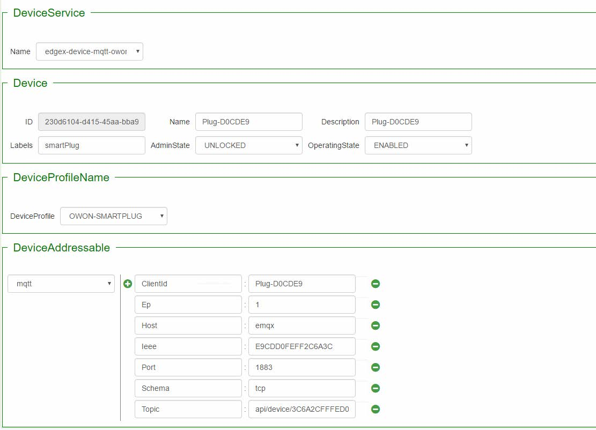<br>
2. Sign in to the EdgeX Foundry server as `root` and restart the container to apply the configuration:<br>
   `docker restart edgex-device-mqtt-owon`

## 6. Integrate the ZhongHong Modbus Gateway
1. Open `http://{EdgeX Foundry server IP address}:4000/` in a browser and sign in.
2. Click the plus sign under **Devices** and add the ZhongHong Modbus gateway. Set the **Name** and **Description** fields as desired. Set the **Labels** field to `air` to identify the device as an air conditioner.
3. Select the profile in the **DeviceProfileName** field. Refer to the list of configuration files in the [Prerequisites](#2-prerequisites) section.
4. Under **DeviceAddressable**, click the plus icon and enter the device details.<br>
   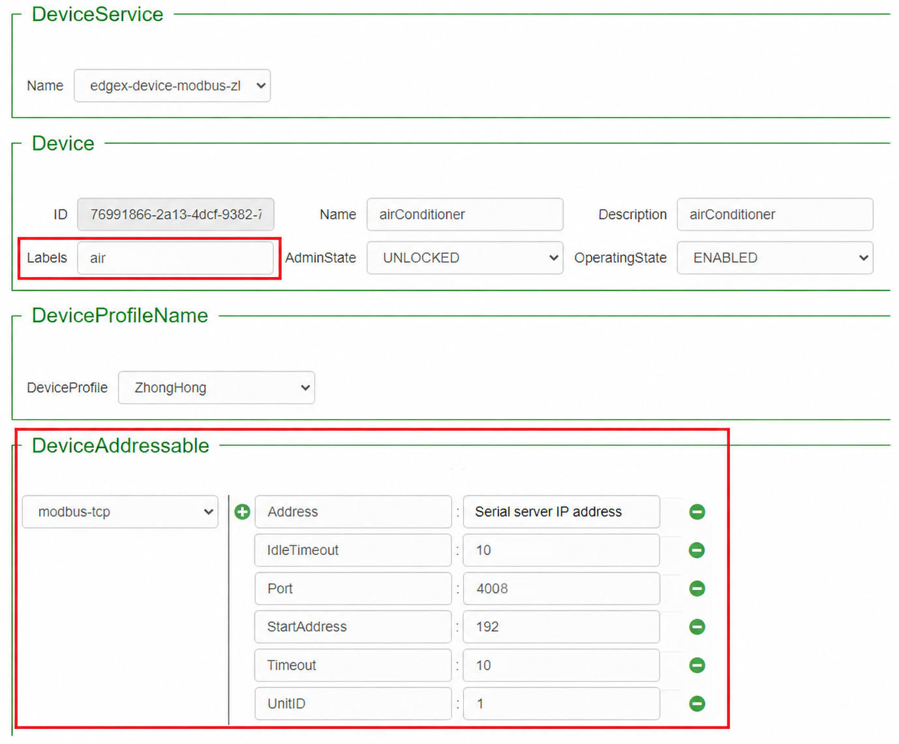<br>
   - **Address**: the serial server's IP address
   - **Timeout**: data read timeout in seconds; this example uses `10`.
   - **IdleTimeout**: TCP connection idle timeout in seconds; this example uses `10`.
   - **Port**: the serial server's local port (`4008`). This value must match the local port configured in Step 3 of the [Configure the Serial Server](#4-configure-the-serial-server) section.
   - **StartAddress**: Modbus start address for the air conditioner, calculated as `(AA × 32 + BB) × 6`. Obtain `AA` and `BB` from the ZhongHong air conditioner web interface. See the manufacturer's *Outdoor Unit Gateway User Manual*.<br>
     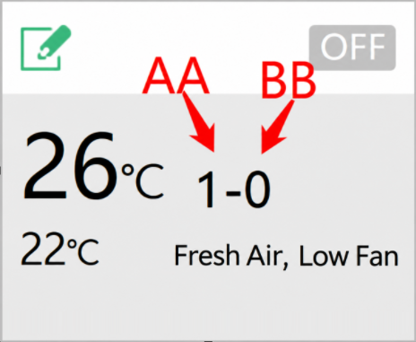<br>
   - **UnitID**: device address configured on the ZhongHong Modbus gateway; this example uses `1`.

   The following gateway management page shows where to find the device address. For more information, see the manufacturer's *Outdoor Unit Gateway User Manual*.<br>
   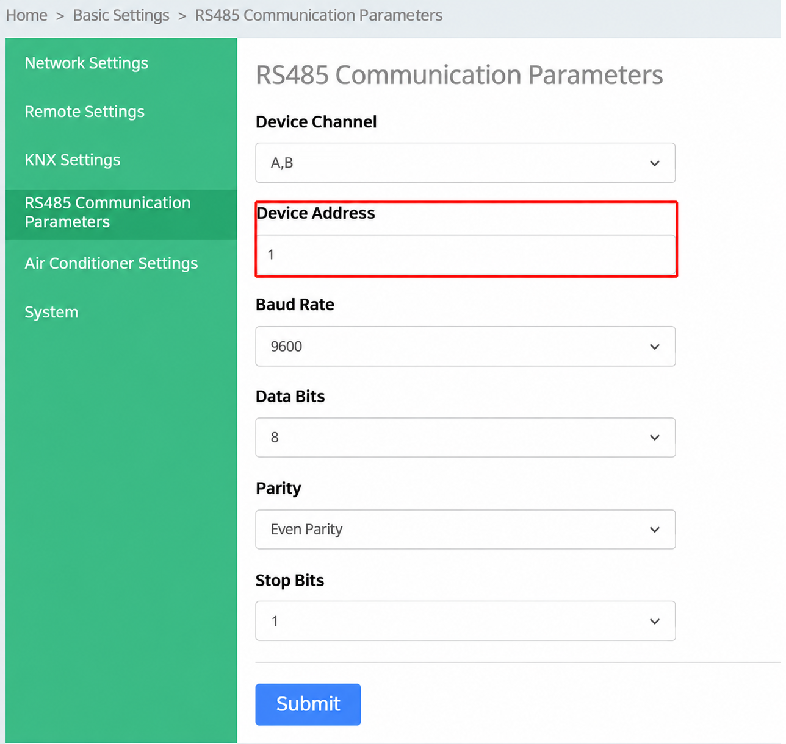<br>

## 7. Integrate the Android Music Box
1. Connect the Android music box to the MQTT broker on the EdgeX Foundry server.
2. Sign in to the EdgeX Foundry server as `root`.
3. Change to `/root`:<br>`cd /root`<br>
4. Start the Android service container:<br>`docker-compose up -d device-mqtt-android`<br>
5. Open `http://{EdgeX Foundry IP address}:4000/` in a browser and sign in.<br>
6. Click the plus sign under **Devices** and add the Android music box with these values:
   - **Schema**: `tcp`
   - **Host**: EdgeX Foundry server IP address
   - **Port**: MQTT service port, `1883`
   - **Clientid**: `clientid`
   - **Topic**: `api/android/{type}/{brand_id}/{mac}`

   Set the `brand_id` field to the brand ID and the `mac` field to the music box MAC address. Set the `type` field to one of the following device types:
   - `VIDEO`: advertising screen
   - `SVIDEO`: synchronized screen
   - `AI`: interactive screen
   - `AUDIO`: music box
7. Restart the container to apply the configuration:<br>`docker restart edgex-device-mqtt-android`

## 8. Troubleshooting
**Symptom**<br>
The following errors occur when running `docker-compose down`:

```text
Stopping edgex-device-mqtt-android            ... error
Stopping edgex-sys-mgmt-agent                 ... error
Stopping edgex-app-service-configurable-rules ... error
Stopping edgex-core-data                      ... error
Stopping edgex-core-command                   ... error
Stopping edgex-core-metadata                  ... error
Stopping edgex-support-notifications          ... error
Stopping edgex-support-scheduler              ... error
Stopping edgex-mqtt-engine                    ... error
Stopping edgex-core-consul                    ... error
Stopping edgex-redis                          ... error
Stopping emqx                                 ... error
Stopping edgex-ui-go                          ... error

ERROR: cannot stop container: runc did not terminate successfully; signaling init process caused "permission denied"
ERROR: error while removing network: network edgex_edgex-network has active endpoints
```

**Resolution**<br>
Run `aa-remove-unknown`, then retry the operation.


