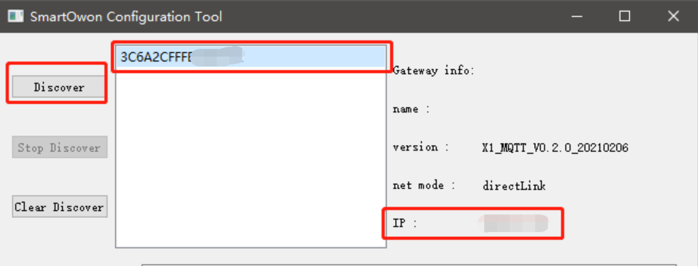

<h1>OWON Smart Gateway Configuration</h1>

- [1. Prerequisites](#1-prerequisites)
- [2. Register the OWON Gateway](#2-register-the-owon-gateway)
- [3. Connect Devices to the OWON Gateway](#3-connect-devices-to-the-owon-gateway)
  - [3.1 Connect the Smart ZigBee Lighting Group](#31-connect-the-smart-zigbee-lighting-group)
  - [3.2 Connect the Smart Lighting Panel](#32-connect-the-smart-lighting-panel)
  - [3.3 Connect the DIN-Rail Relay](#33-connect-the-din-rail-relay)
  - [3.4 Connect the RF Remote and Pair Other Devices](#34-connect-the-rf-remote-and-pair-other-devices)
- [4. Find a Device MAC Address](#4-find-a-device-mac-address)

The OWON gateway acts as the communication hub between devices in an IoT deployment. This guide covers the software prerequisites and configuration procedures.

## 1. Prerequisites

Before configuring the gateway, install the following software on your PC:<br>
- Socket Tool<br>
- Smart OWON Configuration Tool<br>

Install `mosquitto-clients` on the EdgeX Foundry server:<br>
`apt install -y mosquitto-clients`<br>

Contact Hydsoft technical support to obtain the software packages.<br>

## 2. Register the OWON Gateway

Before proceeding, connect the OWON gateway to the network with an Ethernet cable. Ensure that the PC used for configuration and the gateway are on the same LAN.<br>

**Note:** If the gateway was configured previously, reset it as follows: while the gateway is powered off, press and hold the Bluetooth and ZigBee buttons simultaneously. Release them after the gateway starts.<br>

1. Use Smart OWON Configuration Tool to find the gateway IP address.<br>
   <br>
2. In Socket Tool, send the following message to `{OWON gateway IP address}:11500` to register the gateway:<br>
   `{"type":"wizardConfig","command":"serverCfg","argument":{"host":"{EdgeX Foundry IP address}","port":1883},"sequence":1}`<br>
   Port `1883` is the MQTT service port.
3. Send the following message to `{OWON gateway IP address}:11500` to start the gateway and register it with the MQTT server:<br>
   `{"type":"wizardConfig", "command":"startRegister", "sequence":1 }`

## 3. Connect Devices to the OWON Gateway

### 3.1 Connect the Smart ZigBee Lighting Group
1. Power on the smart ZigBee lighting group, leave the lights on, and keep it within the OWON gateway's ZigBee signal range.
2. (Optional) If it was configured before, reset it by switching the lights off and on 10 times. The bulbs flash when the reset is complete.
3. Sign in to the EdgeX Foundry server as `root`.
4. Read the MAC address from the back of the OWON gateway.
5. Run the following command on the EdgeX Foundry server to allow the lighting group to join the ZigBee network:<br>
   `mosquitto_pub -t api/device/{OWON gateway MAC address}/test -m '{"type":"zigbeeConfig","command":"permitJoin", "sequence":1010, "argument": { "switchgear":"on", "second":60 } }'`
6. Verify the connection with the following command:<br>
   `mosquitto_pub -t api/device/{OWON gateway MAC address}/test -m '{ "type":"zigbeeConfig", "command":"epList", "sequence":1009 }'`<br>
   The connection succeeds if the command returns the lighting group's MAC address.

### 3.2 Connect the Smart Lighting Panel
1. Power on the smart lighting panel and keep it within the gateway's ZigBee signal range.
2. Press the panel's ON/OFF button four times. On the fourth press, hold it for six seconds, then release it when the indicator flashes. The panel is now in network-joining mode.
3. Sign in to the EdgeX Foundry server as `root`.
4. Read the MAC address from the back of the OWON gateway.
5. Run the following command to allow the panel to join the ZigBee network:<br>
   `mosquitto_pub -t api/device/{OWON gateway MAC address}/test -m '{"type":"zigbeeConfig","command":"permitJoin", "sequence":1010, "argument": { "switchgear":"on", "second":60 } }'`
6. Verify the connection with the following command:<br>
   `mosquitto_pub -t api/device/{OWON gateway MAC address}/test -m '{ "type":"zigbeeConfig", "command":"epList", "sequence":1009 }'`<br>
   The connection succeeds if the command returns the panel's MAC address.

### 3.3 Connect the DIN-Rail Relay
1. Power on the DIN-rail relay and keep it within the gateway's ZigBee signal range.
2. Press and hold its ON/OFF button for 10 seconds. The indicator flashes three times after 3 seconds and again after 10 seconds. The relay then enters network-joining mode.
3. Sign in to the EdgeX Foundry server as `root`.
4. Read the MAC address from the back of the OWON gateway.
5. Run the following command to allow the relay to join the ZigBee network:<br>
   `mosquitto_pub -t api/device/{OWON gateway MAC address}/test -m '{"type":"zigbeeConfig","command":"permitJoin", "sequence":1010, "argument": { "switchgear":"on", "second":60 } }'`
6. Verify the connection with the following command:<br>
   `mosquitto_pub -t api/device/{OWON gateway MAC address}/test -m '{ "type":"zigbeeConfig", "command":"epList", "sequence":1009 }'`<br>
   The connection succeeds if the command returns the relay's MAC address.

### 3.4 Connect the RF Remote and Pair Other Devices
1. Power on the RF remote and the devices to pair with it (smart ZigBee lighting group, smart lighting panel, and DIN-rail relay). Keep them within the gateway's ZigBee signal range.<br>
2. Press the remote's ON/OFF button four times. On the fourth press, hold it for six seconds, then release it when the indicator flashes. The remote enters network-joining mode.
3. Sign in to the EdgeX Foundry server as `root`.
4. Read the MAC address from the back of the OWON gateway.
5. Run the following command to allow the remote to join the ZigBee network:<br>
   `mosquitto_pub -t api/device/{OWON gateway MAC address}/test -m '{"type":"zigbeeConfig","command":"permitJoin", "sequence":1010, "argument": { "switchgear":"on", "second":60 } }'`
6. List the MAC addresses of devices connected to the gateway:<br>
   `mosquitto_pub -t api/device/{OWON gateway MAC address}/test -m '{ "type":"zigbeeConfig", "command":"epList", "sequence":1009 }'`<br>
   The result includes all devices successfully connected to the gateway, including the RF remote, lighting group, lighting panel, and relay.
7. Run the following command to put the device you want to pair with the remote into identification mode:<br>
   `mosquitto_pub -t api/device/{OWON gateway MAC address}/test -m '{ "type":"identify", "command":"identify", "sequence":1016, "argument": {"ieee":"{device MAC address}", "ep":1, "time":100 } }'`<br>
   Replace `{device MAC address}` with the address found in step 4.
8. Press any button on the RF remote four times. On the fourth press, hold the button until its indicator flashes rapidly, then release it. The device is now paired with the remote.

## 4. Find a Device MAC Address
1. Sign in to the EdgeX Foundry server as `root`.
2. Read the MAC address from the back of the OWON gateway.
3. Run these commands to query the devices connected to the gateway:<br>
   `mosquitto_sub -t reply/device/{OWON gateway MAC address}/test`  
   `mosquitto_pub -t api/device/{OWON gateway MAC address}/test -m '{ "type":"zigbeeConfig", "command":"epList", "sequence":1009 }'`<br>
   The commands return all devices currently connected to the gateway. `name` is the device name, `ieee` is its MAC address, and `devModel` is its model.<br>
   You can identify the device type by the `devModel` field:
   - `FNB56-ZCW39GD1.1`: Smart ZigBee lighting group
   - `SLC600_R3`: RF remote switch
   - `SLC600_L3`: Smart lighting panel
   - `CB432`: DIN-rail relay

   Sample response:

   ```json
   {
     "result": true,
     "description": "epList response success",
     "response": {
       "total": 10,
       "start": 0,
       "count": 10,
       "epList": [
         {"ieee":"CA2B2004008D1500","ep":1,"netDeviceType":1,"linkStatus":false,"deviceType":269,"IASZoneType":65535,"ProfileId":260,"name":"Light-202BCA","manuCode":4478,"devModel":"FNB56-ZCW39GD1.1","clusterFlag":3},
         {"ieee":"22F3D0FEFF2C6A3C","ep":1,"netDeviceType":1,"linkStatus":true,"deviceType":33027,"IASZoneType":65535,"ProfileId":260,"name":"Light-D0F322_01","manuCode":4412,"devModel":"SLC600_R3    ","clusterFlag":0},
         {"ieee":"BEC6D0FEFF2C6A3C","ep":1,"netDeviceType":1,"linkStatus":true,"deviceType":256,"IASZoneType":65535,"ProfileId":260,"name":"Light-D0C6BE_01","manuCode":4412,"devModel":"SLC600_L3    ","clusterFlag":3},
         {"ieee":"19CED0FEFF2C6A3C","ep":1,"netDeviceType":1,"linkStatus":true,"deviceType":9,"IASZoneType":65535,"ProfileId":260,"name":"Plug-D0CE19","manuCode":4412,"devModel":"CB432","clusterFlag":3}
       ]
     },
     "sequence": 1009
   }
   ```


