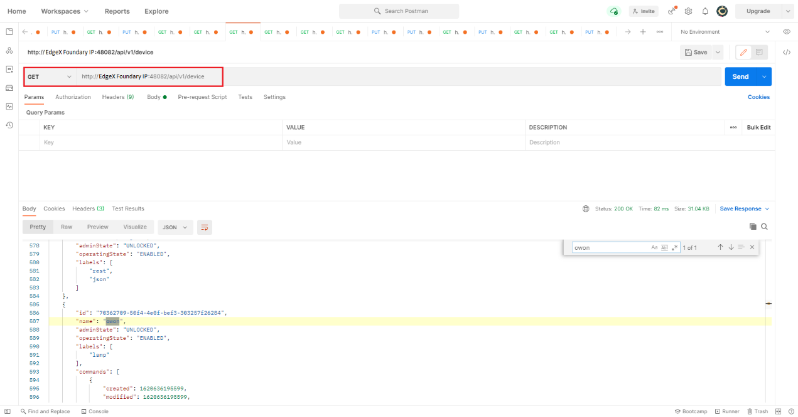

<h1>IoT Device API Reference</h1>

- [1. General APIs](#1-general-apis)
  - [1.1 List All Available Device APIs](#11-list-all-available-device-apis)
- [2. Control Smart ZigBee Lighting Groups](#2-control-smart-zigbee-lighting-groups)
  - [2.1 Get Light Switch Status](#21-get-light-switch-status)
  - [2.2 Set Light Switch Status](#22-set-light-switch-status)
  - [2.3 Get Light Brightness](#23-get-light-brightness)
  - [2.4 Set Light Brightness](#24-set-light-brightness)
  - [2.5 Locate a Light](#25-locate-a-light)
  - [2.6 List Devices Connected to the OWON Gateway](#26-list-devices-connected-to-the-owon-gateway)
  - [2.7 Get Light Color Temperature](#27-get-light-color-temperature)
  - [2.8 Set Light Color Temperature](#28-set-light-color-temperature)
  - [2.9 Get Light Color](#29-get-light-color)
  - [2.10 Set Light Color](#210-set-light-color)
- [3. Control Air Conditioners through the ZhongHong Gateway](#3-control-air-conditioners-through-the-zhonghong-gateway)
  - [3.1 Get Air Conditioner Status](#31-get-air-conditioner-status)
  - [3.2 Set Air Conditioner Power](#32-set-air-conditioner-power)
  - [3.3 Get Air Conditioner Temperature](#33-get-air-conditioner-temperature)
  - [3.4 Set Air Conditioner Temperature](#34-set-air-conditioner-temperature)
  - [3.5 Get Current Air Conditioner Mode](#35-get-current-air-conditioner-mode)
  - [3.6 Set Air Conditioner Mode](#36-set-air-conditioner-mode)
  - [3.7 Get Air Conditioner Fan Speed](#37-get-air-conditioner-fan-speed)
  - [3.8 Set Air Conditioner Fan Speed](#38-set-air-conditioner-fan-speed)
  - [3.9 Get Current Return Air Temperature](#39-get-current-return-air-temperature)
  - [3.10 Get Air Conditioner Fault Status](#310-get-air-conditioner-fault-status)
- [4. Control the Android Music Box](#4-control-the-android-music-box)
  - [4.1 Control Music](#41-control-music)
  - [4.2 Capture and Upload a Device Screenshot](#42-capture-and-upload-a-device-screenshot)
  - [4.3 Control the Device](#43-control-the-device)
  - [4.4 Update Programs](#44-update-programs)
  - [4.5 Update the Program Schedule](#45-update-the-program-schedule)
- [5. Control the Smart Lighting Panel](#5-control-the-smart-lighting-panel)
  - [5.1 Get Switch Status](#51-get-switch-status)
  - [5.2 Set Switch Status](#52-set-switch-status)
- [6. Control the DIN-Rail Relay](#6-control-the-din-rail-relay)
  - [6.1 Get Switch Status](#61-get-switch-status)
  - [6.2 Set Switch Status](#62-set-switch-status)
  - [6.3 Get Real-Time Energy Data](#63-get-real-time-energy-data)
- [7. Query EdgeX Foundry Server Information](#7-query-edgex-foundry-server-information)
  - [7.1 Get Host Information](#71-get-host-information)
  - [7.2 Get CPU Information](#72-get-cpu-information)
  - [7.3 Get Memory Information](#73-get-memory-information)
  - [7.4 Get Disk Information](#74-get-disk-information)
- [8. Appendix](#8-appendix)
  - [8.1 Common Response Parameters](#81-common-response-parameters)
  - [8.2 Status Codes](#82-status-codes)
  - [8.3 Color Code Conversion](#83-color-code-conversion)

  
<br>
EdgeX provides RESTful APIs for managing intelligent devices over HTTP. This guide explains how to call the APIs using Postman.


## 1. General APIs
### 1.1 List All Available Device APIs
**URI**
```html
GET /api/v1/device
```

**Request**<br>
Example：
```html
GET http://{EdgeX Foundry IP address}:48082/api/v1/device
```

**Response**<br>
The response lists all available device APIs.<br>



## 2. Control Smart ZigBee Lighting Groups

### 2.1 Get Light Switch Status
**URI**

```html
GET /api/v1/device/name/{device_name}/command/switch
```

Replace `{device_name}` with the light device name configured in EdgeX Foundry. For details, see <a href="1.%20EdgeX%20Foundry%20Software%20Deployment.md#5-integrate-the-owon-gateway" target="_blank">Integrate the OWON Gateway</a> step 6(4).<br>

**Request**<br>
Example：
```html
GET http://{EdgeX Foundry IP address}:48082/api/v1/device/name/Light-20F1FE/command/switch
```

**Response**<br>
Response parameters:
| Name  | Type | Description                                                                         |
| ----- | -------- | ------ |
| value | String | Returned data   |
|connectionInfo| String  | Connection information |
| response | String | Switch status<br>cache：Cached value<br>switchgear：Switch state: `off` means off; `on` means on  |

For other parameters, see [8.1 Common Response Parameters](#81-Common Response Parameters)。<br>

Example：
```html
{
    "device": "Light-20F1FE",
    "origin": 1629966563580282054,
    "readings": [
        {
            "origin": 1629966563580001105,
            "device": "Light-20F1FE",
            "name": "switch",
            "value": "{\"connectionInfo\":{\"ClientId\":\"Light-20F1FE\",\"Ep\":1,\"Host\":\"emqx\",\"Ieee\":\"FEF12004008D1500\",\"Password\":\"\",\"Port\":\"1883\",\"Schema\":\"tcp\",\"Topic\":\"api/device/3C6A2CFFFED0C559/hydsoft\",\"User\":\"\"},\"response\":{\"cache\":0,\"switchgear\":\"off\"}}",
            "valueType": "String"
        }
    ],
    "EncodedEvent": null
}
```
Status Codes：<br>
A successful response uses a 2xx status code, such as 200 or 204.<br>
For status code meanings and additional codes, see[8.2 Status Codes](#82-Status Codes)。

### 2.2 Set Light Switch Status
**URI**
```html
PUT /api/v1/device/name/{device_name}/command/switch
```

Replace `{device_name}` with the light device name configured in EdgeX Foundry. For details, see <a href="1.%20EdgeX%20Foundry%20Software%20Deployment.md#5-integrate-the-owon-gateway" target="_blank">Integrate the OWON Gateway</a> step 6(4).<br>

**Request**<br>
Request parameters:
| Name                 | Required | Type | Description                                  |
| -------------------- | -------- | -------- | ------------------------------------- |
| switch | Yes       | String   | Light switch state<br>on：Turn the light on<br>off：Turn the light off |


Example：

```html
PUT http://{EdgeX Foundry IP address}:48082/api/v1/device/name/Light-20F1FE/command/switch
```
```html
{
    "switch": "off"
}
```

**Response**<br>
Status Codes：<br>
A successful response uses a 2xx status code, such as 200 or 204.<br>
For status code meanings and additional codes, see[8.2 Status Codes](#82-Status Codes)。
### 2.3 Get Light Brightness
**URI**
```html
GET /api/v1/device/name/{device_name}/command/level
```

Replace `{device_name}` with the light device name configured in EdgeX Foundry. For details, see <a href="1.%20EdgeX%20Foundry%20Software%20Deployment.md#5-integrate-the-owon-gateway" target="_blank">Integrate the OWON Gateway</a> step 6(4).<br>

**Request**<br>
Example：
```html
GET http://{EdgeX Foundry IP address}:48082/api/v1/device/name/Light-20F1FE/command/level
```

**Response**<br>
Response parameters:
| Name  | Type | Description                                                         |
| ----- | -------- | ------------------------------------------------------------ |
| value | String | Returned data   |
|connectionInfo| String  | Connection information |
| response | String | light brightness<br>`level` range: 0–255<br>Higher values indicate greater brightness  |

For other parameters, see [8.1 Common Response Parameters](#81-Common Response Parameters)。<br>

Example：
```html
{
    "device": "Light-20F1FE",
    "origin": 1629967582568115849,
    "readings": [
        {
            "origin": 1629967582567757368,
            "device": "Light-20F1FE",
            "name": "level",
            "value": "{\"connectionInfo\":{\"ClientId\":\"Light-20F1FE\",\"Ep\":1,\"Host\":\"emqx\",\"Ieee\":\"FEF12004008D1500\",\"Password\":\"\",\"Port\":\"1883\",\"Schema\":\"tcp\",\"Topic\":\"api/device/3C6A2CFFFED0C559/hydsoft\",\"User\":\"\"},\"response\":{\"level\":100}}",
            "valueType": "String"
        }
    ],
    "EncodedEvent": null
}
```

Status Codes：<br>
A successful response uses a 2xx status code, such as 200 or 204.<br>
For status code meanings and additional codes, see[8.2 Status Codes](#82-Status Codes)。<br>

### 2.4 Set Light Brightness
**URI**

```html
PUT /api/v1/device/name/{device_name}/command/level
```

Replace `{device_name}` with the light device name configured in EdgeX Foundry. For details, see <a href="1.%20EdgeX%20Foundry%20Software%20Deployment.md#5-integrate-the-owon-gateway" target="_blank">Integrate the OWON Gateway</a> step 6(4).<br>

**Request**<br>
Request parameters:
| Name                | Required | Type | Description                                                |
| ------------------- | -------- | -------- | --------------------------------------------------- |
| level | Yes       | String   | light Brightness<br>Value range: 0–255<br>Higher values indicate greater brightness |

Example：

```html
PUT http://{EdgeX Foundry IP address}:48082/api/v1/device/name/Light-20F1FE/command/level
```
```html
{
   "level":"30"
}
```

**Response**<br>
Status Codes：<br>
A successful response uses a 2xx status code, such as 200 or 204.<br>
For status code meanings and additional codes, see[8.2 Status Codes](#82-Status Codes)。

### 2.5 Locate a Light
**URI**

```html
PUT /api/v1/device/name/{device_name}/command/findNode
```

Replace `{device_name}` with the light device name configured in EdgeX Foundry. For details, see <a href="1.%20EdgeX%20Foundry%20Software%20Deployment.md#5-integrate-the-owon-gateway" target="_blank">Integrate the OWON Gateway</a> step 6(4).<br>

**Request**<br>
Request parameters:
| Name                   | Required | Type | Description                                                                           |
| ---------------------- | -------- | -------- | ------------------------------------------------------------------------------ |
| findNode | Yes       | String   | Duration for which the light flashes<br>Range: 1–60 seconds<br>Use the flashing light to locate it. |

Example：
```html
PUT http://{EdgeX Foundry IP address}:48082/api/v1/device/name/Light-20F1FE/command/findNode
```
```html
{
   "findNode":"10"
}
```

**Response**<br>
Status Codes：<br>
A successful response uses a 2xx status code, such as 200 or 204.<br>
For status code meanings and additional codes, see[8.2 Status Codes](#82-Status Codes)。

### 2.6 List Devices Connected to the OWON Gateway
**URI**<br>
```html
GET /api/v1/device/name/{device_name}/command/listAllDev
```

Replace `{device_name}` with the light device name configured in EdgeX Foundry. For details, see <a href="1.%20EdgeX%20Foundry%20Software%20Deployment.md#5-integrate-the-owon-gateway" target="_blank">Integrate the OWON Gateway</a> step 6(4).<br> 

**Request**<br>
Example：

```html
GET http://{EdgeX Foundry IP address}:48082/api/v1/device/name/owon/command/listAllDev
```
**Response**<br>
Response parameters:
| Name | Type | Description                   |
| ----- | -------- | ---------------------- |
| value | String | Returned data   |
|connectionInfo| String  | Connection information |
| response | String | Devices connected to the OWON gateway |

For other parameters, see [8.1 Common Response Parameters](#81-Common Response Parameters)。<br>

Example：
```html
{
    "device": "owon",
    "origin": 1630049736126621866,
    "readings": [
        {
            "origin": 1630049736126423190,
            "device": "owon",
            "name": "listAllDev",
            "value": "{\"connectionInfo\":{\"ClientId\":\"owon-gateway\",\"Ep\":0,\"Host\":\"emqx\",\"Ieee\":\"\",\"Password\":\"\",\"Port\":\"1883\",\"Schema\":\"tcp\",\"Topic\":\"api/device/3C6A2CFFFED0C559/hydsoft\",\"User\":\"\"},\"response\":{\"count\":11,\"epList\":[{\"IASZoneType\":65535,\"ProfileId\":260,\"clusterFlag\":3,\"devModel\":\"FNB56-ZCW39GD1.1\",\"deviceType\":269,\"ep\":1,\"ieee\":\"CA2B2004008D1500\",\"linkStatus\":false,\"manuCode\":4478,\"name\":\"Light-202BCA\",\"netDeviceType\":1},{\"IASZoneType\":65535,\"ProfileId\":260,\"clusterFlag\":0,\"devModel\":\"SLC600_R3    \",\"deviceType\":33027,\"ep\":1,\"ieee\":\"22F3D0FEFF2C6A3C\",\"linkStatus\":true,\"manuCode\":4412,\"name\":\"Light-D0F322_01\",\"netDeviceType\":1},{\"IASZoneType\":65535,\"ProfileId\":260,\"clusterFlag\":0,\"devModel\":\"SLC600_R3    \",\"deviceType\":33027,\"ep\":2,\"ieee\":\"22F3D0FEFF2C6A3C\",\"linkStatus\":true,\"manuCode\":4412,\"name\":\"Light-D0F322_02\",\"netDeviceType\":1},{\"IASZoneType\":65535,\"ProfileId\":260,\"clusterFlag\":0,\"devModel\":\"SLC600_R3    \",\"deviceType\":33027,\"ep\":3,\"ieee\":\"22F3D0FEFF2C6A3C\",\"linkStatus\":true,\"manuCode\":4412,\"name\":\"Light-D0F322_03\",\"netDeviceType\":1},{\"IASZoneType\":65535,\"ProfileId\":260,\"clusterFlag\":3,\"devModel\":\"SLC600_L3    \",\"deviceType\":256,\"ep\":1,\"ieee\":\"BEC6D0FEFF2C6A3C\",\"linkStatus\":true,\"manuCode\":4412,\"name\":\"Light-D0C6BE_01\",\"netDeviceType\":1},{\"IASZoneType\":65535,\"ProfileId\":260,\"clusterFlag\":3,\"devModel\":\"SLC600_L3    \",\"deviceType\":256,\"ep\":2,\"ieee\":\"BEC6D0FEFF2C6A3C\",\"linkStatus\":true,\"manuCode\":4412,\"name\":\"Light-D0C6BE_02\",\"netDeviceType\":1},{\"IASZoneType\":65535,\"ProfileId\":260,\"clusterFlag\":3,\"devModel\":\"SLC600_L3    \",\"deviceType\":256,\"ep\":3,\"ieee\":\"BEC6D0FEFF2C6A3C\",\"linkStatus\":true,\"manuCode\":4412,\"name\":\"Light-D0C6BE_03\",\"netDeviceType\":1},{\"IASZoneType\":65535,\"ProfileId\":260,\"clusterFlag\":3,\"devModel\":\"CB432\",\"deviceType\":9,\"ep\":1,\"ieee\":\"E9CDD0FEFF2C6A3C\",\"linkStatus\":true,\"manuCode\":4412,\"name\":\"Plug-D0CDE9\",\"netDeviceType\":1},{\"IASZoneType\":65535,\"ProfileId\":260,\"clusterFlag\":3,\"devModel\":\"CB432\",\"deviceType\":9,\"ep\":1,\"ieee\":\"19CED0FEFF2C6A3C\",\"linkStatus\":true,\"manuCode\":4412,\"name\":\"Plug-D0CE19\",\"netDeviceType\":1},{\"IASZoneType\":65535,\"ProfileId\":260,\"clusterFlag\":3,\"devModel\":\"FNB56-ZCW39GD1.1\",\"deviceType\":269,\"ep\":1,\"ieee\":\"FEF12004008D1500\",\"linkStatus\":true,\"manuCode\":4478,\"name\":\"Light-20F1FE\",\"netDeviceType\":1},{\"IASZoneType\":65535,\"ProfileId\":260,\"clusterFlag\":3,\"devModel\":\"FNB56-ZCW39GD1.1\",\"deviceType\":269,\"ep\":1,\"ieee\":\"232B2004008D1500\",\"linkStatus\":true,\"manuCode\":4478,\"name\":\"Light-202B23\",\"netDeviceType\":1}],\"start\":0,\"total\":11}}",
            "valueType": "String"
        }
    ],
    "EncodedEvent": null
}
```

Status Codes：<br>
A successful response uses a 2xx status code, such as 200 or 204.<br>
For status code meanings and additional codes, see[8.2 Status Codes](#82-Status Codes)。

### 2.7 Get Light Color Temperature
**URI**

```html
GET /api/v1/device/name/{device_name}/command/color
```

Replace `{device_name}` with the light device name configured in EdgeX Foundry. For details, see <a href="1.%20EdgeX%20Foundry%20Software%20Deployment.md#5-integrate-the-owon-gateway" target="_blank">Integrate the OWON Gateway</a> step 6(4).<br>

**Request**<br>
Example：

```html
GET http://{EdgeX Foundry IP address}:48082/api/v1/device/name/Light-20F1FE/command/color
```

**Response**<br>
Response parameters:
| Name  | Type | Description                                                       |
| ----- | -------- | ---------------------------------------------------------- |
| value | String | Returned data |
|connectionInfo| String  | Connection information |
| response | String | Light color temperature<br>`colorTemp` range: 1–370<br>Higher values produce warmer light |

For other parameters, see [8.1 Common Response Parameters](#81-Common Response Parameters)。<br>

Example：
```html
{
    "device": "Light-20F1FE",
    "origin": 1629971733987042126,
    "readings": [
        {
            "origin": 1629971733986661988,
            "device": "Light-20F1FE",
            "name": "color",
            "value": "{\"connectionInfo\":{\"ClientId\":\"Light-20F1FE\",\"Ep\":1,\"Host\":\"emqx\",\"Ieee\":\"FEF12004008D1500\",\"Password\":\"\",\"Port\":\"1883\",\"Schema\":\"tcp\",\"Topic\":\"api/device/3C6A2CFFFED0C559/hydsoft\",\"User\":\"\"},\"response\":{\"colorTemp\":256,\"status\":0}}",
            "valueType": "String"
        }
    ],
    "EncodedEvent": null
}
```

Status Codes：<br>
A successful response uses a 2xx status code, such as 200 or 204.<br>
For status code meanings and additional codes, see[8.2 Status Codes](#82-Status Codes)。

### 2.8 Set Light Color Temperature
**URI**
```html
PUT /api/v1/device/name/{device_name}/command/color
```

Replace `{device_name}` with the light device name configured in EdgeX Foundry. For details, see <a href="1.%20EdgeX%20Foundry%20Software%20Deployment.md#5-integrate-the-owon-gateway" target="_blank">Integrate the OWON Gateway</a> step 6(4).<br>

**Request**<br>
Request parameters:
| Name                | Required | Type | Description                                                  |
| ------------------- | -------- | -------- | ----------------------------------------------------- |
| color | Yes       | String   | Color temperature to set<br>Value range: 1–370<br>Higher values produce warmer light |

Example：
```html
PUT http://{EdgeX Foundry IP address}:48082/api/v1/device/name/Light-20F1FE/command/color
```
```html
{
   "color":"320"
}
```

**Response**<br>
Status Codes：<br>
A successful response uses a 2xx status code, such as 200 or 204.<br>
For status code meanings and additional codes, see[8.2 Status Codes](#82-Status Codes)。

### 2.9 Get Light Color

**URI**
```bash
GET /api/v1/device/name/{device_name}/command/colorXY
```

Replace `{device_name}` with the light device name configured in EdgeX Foundry. For details, see <a href="1.%20EdgeX%20Foundry%20Software%20Deployment.md#5-integrate-the-owon-gateway" target="_blank">Integrate the OWON Gateway</a> step 6(4).<br>

**Request**<br>
Example：

```bash
GET http://{EdgeX Foundry IP address}:48082/api/v1/device/name/Light-20F1FE/command/colorXY
```

**Response**<br>
Response parameters:
| Name  | Type | Description                                                                                                     |
| ----- | -------- | -------------------------------------------------------------------------------------------------------- |
| value | String | Returned data   |
|connectionInfo| String  | Connection information |
| response | String | Light color<br>`colorX` and `colorY` are light color coordinates.<br>For conversion between these coordinates and RGB color codes, see [8.3 Color Code Conversion](#83-Color Code Conversion)。 |

For other parameters, see [8.1 Common Response Parameters](#81-Common Response Parameters)。<br>

Example：
```html
{
    "device": "Light-20F1FE",
    "origin": 1629971869175076079,
    "readings": [
        {
            "origin": 1629971869174709699,
            "device": "Light-20F1FE",
            "name": "colorXY",
            "value": "{\"connectionInfo\":{\"ClientId\":\"Light-20F1FE\",\"Ep\":1,\"Host\":\"emqx\",\"Ieee\":\"FEF12004008D1500\",\"Password\":\"\",\"Port\":\"1883\",\"Schema\":\"tcp\",\"Topic\":\"api/device/3C6A2CFFFED0C559/hydsoft\",\"User\":\"\"},\"response\":{\"colorX\":28065,\"colorY\":26269}}",
            "valueType": "String"
        }
    ],
    "EncodedEvent": null
}
```

Status Codes：<br>
A successful response uses a 2xx status code, such as 200 or 204.<br>
For status code meanings and additional codes, see[8.2 Status Codes](#82-Status Codes)。<br>

### 2.10 Set Light Color
**URI**
```html
PUT /api/v1/device/name/{device_name}/command/colorXY
```

Replace `{device_name}` with the light device name configured in EdgeX Foundry. For details, see <a href="1.%20EdgeX%20Foundry%20Software%20Deployment.md#5-integrate-the-owon-gateway" target="_blank">Integrate the OWON Gateway</a> step 6(4).<br>

**Request**<br>
Request parameters:
| Name                  | Required | Type | Description                                                                                                     |
| --------------------- | -------- | -------- | -------------------------------------------------------------------------------------------------------- |
| colorXY | Yes       | String   | Light color<br>`colorX` and `colorY` are light color coordinates.<br>For conversion between these coordinates and RGB color codes, see “[8.3 Color Code Conversion](#83-Color Code Conversion)”。 |


Example：
```html
PUT http://{EdgeX Foundry IP address}:48082/api/v1/device/name/Light-20F1FE/command/colorXY
```
```html
{
    "colorXY": 
    "{\"colorX\":20494, \"colorY\":21561}"
}
```

**Response**<br>
Status Codes：<br>
A successful response uses a 2xx status code, such as 200 or 204.<br>
For status code meanings and additional codes, see[8.2 Status Codes](#82-Status Codes)。


## 3. Control Air Conditioners through the ZhongHong Gateway

### 3.1 Get Air Conditioner Status
**URI**
```html
GET /api/v1/device/name/{device_name}/command/PowerGet
```

Replace `{device_name}` with the air conditioner device name configured in EdgeX Foundry. For details, see <a href="1.%20EdgeX%20Foundry%20Software%20Deployment.md#6-integrate-the-zhonghong-modbus-gateway" target="_blank">Integrate the ZhongHong Modbus Gateway</a> step 3.<br>

**Request**<br>
Request Example：

```html
GET http://{EdgeX Foundry IP address}:48082/api/v1/device/name/airConditioner/command/PowerGet
```

**Response**<br>
Response parameters:
| Name  | Type | Description                             |
| ----- | -------- | -------------------------------- |
| value | String | Returned data   |
|connectionInfo| String  | Connection information |
| response | String | Air conditioner status<br>1: On<br>0: Off |

For other parameters, see [8.1 Common Response Parameters](#81-Common Response Parameters)。<br>

Example：

```html
"device": "airConditioner",
    "origin": 1630029656440953946,
    "readings": [
        {
            "origin": 1630029656440693731,
            "device": "airConditioner",
            "name": "PowerGet",
            "value": "{\"connectionInfo\":{\"Address\":\"10.90.0.9\",\"IdleTimeout\":\"10\",\"Port\":\"4001\",\"StartAddress\":\"192\",\"Timeout\":\"10\",\"UnitID\":\"1\"},\"response\":0}",
            "valueType": "String"
        }
    ],
    "EncodedEvent": null
}
```

Status Codes：<br>
A successful response uses a 2xx status code, such as 200 or 204.<br>
For status code meanings and additional codes, see[8.2 Status Codes](#82-Status Codes)。

### 3.2 Set Air Conditioner Power
**URI**

```html
PUT /api/v1/device/name/{device_name}/command/PowerSet
```

Replace `{device_name}` with the air conditioner device name configured in EdgeX Foundry. For details, see <a href="1.%20EdgeX%20Foundry%20Software%20Deployment.md#6-integrate-the-zhonghong-modbus-gateway" target="_blank">Integrate the ZhongHong Modbus Gateway</a> step 3.<br>

**Request**<br>
Request parameters:
| Name                            | Required | Type | Description                                     |
| ------------------------------- | -------- | -------- | ---------------------------------------- |
| PowerSet | Yes       | String   | Air conditioner power state<br>0：Off<br>1：On |

Example：

```html
PUT http://{EdgeX Foundry IP address}:48082/api/v1/device/name/airConditioner/command/PowerSet
```
```html
{
   "PowerSet":"0"
}
```

**Response**<br>
Status Codes：<br>
A successful response uses a 2xx status code, such as 200 or 204.<br>
For status code meanings and additional codes, see[8.2 Status Codes](#82-Status Codes)。

### 3.3 Get Air Conditioner Temperature
**URI**

```html
GET /api/v1/device/name/{device_name}/command/TemperatureGet
```

Replace `{device_name}` with the air conditioner device name configured in EdgeX Foundry. For details, see <a href="1.%20EdgeX%20Foundry%20Software%20Deployment.md#6-integrate-the-zhonghong-modbus-gateway" target="_blank">Integrate the ZhongHong Modbus Gateway</a> step 3.<br>

**Request**<br>
Example：

```html
GET http://{EdgeX Foundry IP address}:48082/api/v1/device/name/airConditioner/command/TemperatureGet
```

**Response**<br>
Response parameters:
| Name  | Type | Description                             |
| ----- | -------- | -------------------------------- |
| value | String | Returned data |
|connectionInfo| String  | Connection information |
| response | String | Air conditioner temperature<br>Range: 16–32 |

For other parameters, see [8.1 Common Response Parameters](#81-Common Response Parameters)。<br>

Example：
```html
{
    "device": "airConditioner",
    "origin": 1630029733324704672,
    "readings": [
        {
            "origin": 1630029733324372288,
            "device": "airConditioner",
            "name": "TemperatureGet",
            "value": "{\"connectionInfo\":{\"Address\":\"10.90.0.9\",\"IdleTimeout\":\"10\",\"Port\":\"4001\",\"StartAddress\":\"192\",\"Timeout\":\"10\",\"UnitID\":\"1\"},\"response\":26}",
            "valueType": "String"
        }
    ],
    "EncodedEvent": null
}
```

Status Codes：<br>
A successful response uses a 2xx status code, such as 200 or 204.<br>
For status code meanings and additional codes, see[8.2 Status Codes](#82-Status Codes)。

### 3.4 Set Air Conditioner Temperature
**URI**

```html
PUT /api/v1/device/name/{device_name}/command/TemperatureSet
```

Replace `{device_name}` with the air conditioner device name configured in EdgeX Foundry. For details, see <a href="1.%20EdgeX%20Foundry%20Software%20Deployment.md#6-integrate-the-zhonghong-modbus-gateway" target="_blank">Integrate the ZhongHong Modbus Gateway</a> step 3.<br>

**Request**<br>
Request parameters:
| Name                            | Required | Type | Description                                     |
| ------------------------------- | -------- | -------- | ---------------------------------------- |
| TemperatureSet | Yes       | String   | Air conditioner temperature<br>Range: 16–32 |

Example：

```html
PUT http://{EdgeX Foundry IP address}:48082/api/v1/device/name/airConditioner/command/TemperatureSet
```
```html
{
   "TemperatureSet":"30"
}
```

**Response**<br>
Status Codes：<br>
A successful response uses a 2xx status code, such as 200 or 204.<br>
For status code meanings and additional codes, see[8.2 Status Codes](#82-Status Codes)。

### 3.5 Get Current Air Conditioner Mode

**URI**
```html
GET /api/v1/device/name/{device_name}/command/ModelGet
```

Replace `{device_name}` with the air conditioner device name configured in EdgeX Foundry. For details, see <a href="1.%20EdgeX%20Foundry%20Software%20Deployment.md#6-integrate-the-zhonghong-modbus-gateway" target="_blank">Integrate the ZhongHong Modbus Gateway</a> step 3.<br>

**Request**<br>
Example：

```html
GET http://{EdgeX Foundry IP address}:48082/api/v1/device/name/airConditioner/command/ModelGet
```

**Response**<br>
Response parameters:
| Name  | Type | Description                             |
| ----- | -------- | -------------------------------- |
| value | String | Returned data |
|connectionInfo| String  | Connection information |
| response | String | Air conditioner mode<br>1: Cooling<br>2: Dehumidifying<br>4: Fan only<br>8: Heating |

For other parameters, see [8.1 Common Response Parameters](#81-Common Response Parameters)。<br>

Example：
```html
{
    "device": "airConditioner",
    "origin": 1630029774067064203,
    "readings": [
        {
            "origin": 1630029774066878520,
            "device": "airConditioner",
            "name": "ModelGet",
            "value": "{\"connectionInfo\":{\"Address\":\"10.90.0.9\",\"IdleTimeout\":\"10\",\"Port\":\"4001\",\"StartAddress\":\"192\",\"Timeout\":\"10\",\"UnitID\":\"1\"},\"response\":4}",
            "valueType": "String"
        }
    ],
    "EncodedEvent": null
}
```

Status Codes：<br>
A successful response uses a 2xx status code, such as 200 or 204.<br>
For status code meanings and additional codes, see[8.2 Status Codes](#82-Status Codes)。

### 3.6 Set Air Conditioner Mode
**URI**
```html
PUT /api/v1/device/name/{device_name}/command/ModelSet
```

Replace `{device_name}` with the air conditioner device name configured in EdgeX Foundry. For details, see <a href="1.%20EdgeX%20Foundry%20Software%20Deployment.md#6-integrate-the-zhonghong-modbus-gateway" target="_blank">Integrate the ZhongHong Modbus Gateway</a> step 3.<br>

**Request**<br>
Request parameters:
| Name                            | Required | Type | Description                                     |
| ------------------------------- | -------- | -------- | ---------------------------------------- |
| ModelSet | Yes       | String   | Air conditioner mode<br>1: Cooling<br>2: Dehumidifying<br>4: Fan only<br>8: Heating |

Example：
```html
PUT http://{EdgeX Foundry IP address}:48082/api/v1/device/name/airConditioner/command/ModelSet
```
```html
{
   "ModelSet":"2"
}
```

**Response**<br>
Status Codes：<br>
A successful response uses a 2xx status code, such as 200 or 204.<br>
For status code meanings and additional codes, see[8.2 Status Codes](#82-Status Codes)。

### 3.7 Get Air Conditioner Fan Speed
**URI**

```html
GET /api/v1/device/name/{device_name}/command/WindSpeedGet
```

Replace `{device_name}` with the air conditioner device name configured in EdgeX Foundry. For details, see <a href="1.%20EdgeX%20Foundry%20Software%20Deployment.md#6-integrate-the-zhonghong-modbus-gateway" target="_blank">Integrate the ZhongHong Modbus Gateway</a> step 3.<br>

**Request**<br>
Example：

```html
GET http://{EdgeX Foundry IP address}:48082/api/v1/device/name/airConditioner/command/WindSpeedGet
```

**Response**<br>
Response parameters:
| Name  | Type | Description                             |
| ----- | -------- | -------------------------------- |
| value | String | Returned data |
|connectionInfo| String  | Connection information |
| response | String | Air conditioner fan speed<br>1: High<br>2: Medium<br>4: Low |

For other parameters, see [8.1 Common Response Parameters](#81-Common Response Parameters)。<br>

Example：
```html
{
    "device": "airConditioner",
    "origin": 1630030295222487715,
    "readings": [
        {
            "origin": 1630030295222178662,
            "device": "airConditioner",
            "name": "WindSpeedGet",
            "value": "{\"connectionInfo\":{\"Address\":\"10.90.0.9\",\"IdleTimeout\":\"10\",\"Port\":\"4001\",\"StartAddress\":\"192\",\"Timeout\":\"10\",\"UnitID\":\"1\"},\"response\":4}",
            "valueType": "String"
        }
    ],
    "EncodedEvent": null
}
```

Status Codes：<br>
A successful response uses a 2xx status code, such as 200 or 204.<br>
For status code meanings and additional codes, see[8.2 Status Codes](#82-Status Codes)。

### 3.8 Set Air Conditioner Fan Speed
**URI**

```html
PUT /api/v1/device/name/{device_name}/command/WindSpeedSet
```

Replace `{device_name}` with the air conditioner device name configured in EdgeX Foundry. For details, see <a href="1.%20EdgeX%20Foundry%20Software%20Deployment.md#6-integrate-the-zhonghong-modbus-gateway" target="_blank">Integrate the ZhongHong Modbus Gateway</a> step 3.<br>

**Request**<br>
Request parameters:
| Name                            | Required | Type | Description                                     |
| ------------------------------- | -------- | -------- | ---------------------------------------- |
| WindSpeedSet | Yes       | String   | Air conditioner fan speed<br>1: High<br>2: Medium<br>4: Low |

Example：

```html
PUT http://{EdgeX Foundry IP address}:48082/api/v1/device/name/airConditioner/command/WindSpeedSet
```
```html
{
   "WindSpeedSet":"2"
}
```

**Response**<br>
Status Codes：<br>
A successful response uses a 2xx status code, such as 200 or 204.<br>
For status code meanings and additional codes, see[8.2 Status Codes](#82-Status Codes)。

### 3.9 Get Current Return Air Temperature
**URI**

```html
GET /api/v1/device/name/{device_name}/command/CurrentTemperatureGet
```

Replace `{device_name}` with the air conditioner device name configured in EdgeX Foundry. For details, see <a href="1.%20EdgeX%20Foundry%20Software%20Deployment.md#6-integrate-the-zhonghong-modbus-gateway" target="_blank">Integrate the ZhongHong Modbus Gateway</a> step 3.<br>

**Request**<br>
Example：

```html
GET http://{EdgeX Foundry IP address}:48082/api/v1/device/name/airConditioner/command/CurrentTemperatureGet
```

**Response**<br>
Response parameters:
| Name  | Type | Description                             |
| ----- | -------- | -------------------------------- |
| value | String | Returned data |
|connectionInfo| String  | Connection information |
| response | String | Air conditioner return air temperature |

For other parameters, see [8.1 Common Response Parameters](#81-Common Response Parameters)。<br>

Example：

```html
{
    "device": "airConditioner",
    "origin": 1630030345083048848,
    "readings": [
        {
            "origin": 1630030345082793426,
            "device": "airConditioner",
            "name": "CurrentTemperatureGet",
            "value": "{\"connectionInfo\":{\"Address\":\"10.90.0.9\",\"IdleTimeout\":\"10\",\"Port\":\"4001\",\"StartAddress\":\"192\",\"Timeout\":\"10\",\"UnitID\":\"1\"},\"response\":23}",
            "valueType": "String"
        }
    ],
    "EncodedEvent": null
}
```

Status Codes：<br>
A successful response uses a 2xx status code, such as 200 or 204.<br>
For status code meanings and additional codes, see[8.2 Status Codes](#82-Status Codes)。

### 3.10 Get Air Conditioner Fault Status
**URI**

```html
GET /api/v1/device/name/{device_name}/command/ErrorGet
```

Replace `{device_name}` with the air conditioner device name configured in EdgeX Foundry. For details, see <a href="1.%20EdgeX%20Foundry%20Software%20Deployment.md#6-integrate-the-zhonghong-modbus-gateway" target="_blank">Integrate the ZhongHong Modbus Gateway</a> step 3.<br>

**Request**<br>
Example：

```html
GET http://{EdgeX Foundry IP address}:48082/api/v1/device/name/airConditioner/command/ErrorGet
```

**Response**<br>
Response parameters:
| Name  | Type | Description                             |
| ----- | -------- | -------------------------------- |
| value | String | Returned data |
|connectionInfo| String  | Connection information |
| response | String | Air conditioner status code<br>0: No fault.<br>Other values indicate a device fault; contact ZhongHong technical support. |

For other parameters, see [8.1 Common Response Parameters](#81-Common Response Parameters)。<br>

Example：
```html
{
    "device": "airConditioner",
    "origin": 1630030484446788962,
    "readings": [
        {
            "origin": 1630030484446586772,
            "device": "airConditioner",
            "name": "ErrorGet",
            "value": "{\"connectionInfo\":{\"Address\":\"10.90.0.9\",\"IdleTimeout\":\"10\",\"Port\":\"4001\",\"StartAddress\":\"192\",\"Timeout\":\"10\",\"UnitID\":\"1\"},\"response\":0}",
            "valueType": "String"
        }
    ],
    "EncodedEvent": null
}
```

Status Codes：<br>
A successful response uses a 2xx status code, such as 200 or 204.<br>
For status code meanings and additional codes, see[8.2 Status Codes](#82-Status Codes)。<br>

## 4. Control the Android Music Box

### 4.1 Control Music

**URI**

```html
PUT /api/v1/device/name/android/command/music_control
```

**Request**<br>
Request parameters:   

| Name                 | Required | Type | Description                                  |
| -------------------- | -------- | -------- | ------------------------------------- |
| music_control​​​​​​ | Yes       | String   | Music control operation<br>mac：Android music box MAC address<br>action：Music command; allowed values:<br>play：Play<br>pre：Previous track<br>next：Next track<br>pause：Pause<br>prelist: Previous playlist<br>nextlist：Next playlist<br>jump：Switch track<br>audio_id：Music file ID<br>When `action` is `jump`, set `audio_id` to the target music file ID; otherwise set it to `0`.<br>program_id：Playlist ID<br>When `action` is `jump`, set `program_id` to the target playlist ID; otherwise set it to `0`.<br> |


Example：

```html
PUT http://{EdgeX Foundry IP address}:48082/api/v1/device/name/android/command/music_control
```
```html
{"music_control":
                "{\"mac\":\"38CA73126BCB\",\"action\":\"pause\",\"audio_id\":0,\"program_id\":0}"
}
```

**Response**<br>
Status Codes：<br>
A successful response uses a 2xx status code, such as 200 or 204.<br>
For status code meanings and additional codes, see[8.2 Status Codes](#82-Status Codes)。

### 4.2 Capture and Upload a Device Screenshot

**URI**

```html
PUT /api/v1/device/name/android/command/screenshot
```

**Request**<br>
Request parameters:

| Name                 | Required | Type | Description                                  |
| -------------------- | -------- | -------- | ------------------------------------- |
| screenshot​​​​​​ | Yes       | String   | Screenshot capture and upload settings<br>mac：Android music box MAC address<br>delay：Screenshot interval in seconds<br>num：Number of screenshots to upload|

Example：

```html
PUT http://{EdgeX Foundry IP address}:48082/api/v1/device/name/android/command/screenshot
```
```html
{"screenshot":
            "{\"mac\":\"38CA73126BCB\",\"delay\":1,\"num\":1}"
}
```

**Response**<br>
Status Codes：<br>
A successful response uses a 2xx status code, such as 200 or 204.<br>
For status code meanings and additional codes, see[8.2 Status Codes](#82-Status Codes)。

### 4.3 Control the Device

**URI**

```html
PUT /api/v1/device/name/android/command/device_control
```

**Request**<br>
Request parameters:

| Name                 | Required | Type | Description                                  |
| -------------------- | -------- | -------- | ------------------------------------- |
| device_control | Yes       | String   | Device control settings<br>mac：Android music box MAC address<br>switch：Device power; `1` means on and `0` means off<br>backlight：Screen brightness; range: 0–100<br>volume：Volume; range: 0–100<br>rotation：Screen rotation; allowed values: 0, 90, 180, or 270 |

Example：

```html
PUT http://{EdgeX Foundry IP address}:48082/api/v1/device/name/android/command/device_control
```
```html
{"device_control":
                "{\"mac\":\"38CA73126BCB\",\"switch\": 0, \"backlight\":100, \"volume\": 90,\"rotation\": 0 } "
}
```

**Response**<br>
Status Codes：<br>
A successful response uses a 2xx status code, such as 200 or 204.<br>
For status code meanings and additional codes, see[8.2 Status Codes](#82-Status Codes)。

### 4.4 Update Programs

**URI**

```html
PUT /api/v1/device/name/android/command/program
```

**Request**<br>
Request parameters:

| Name                 | Required | Type | Description                                  |
| -------------------- | -------- | -------- | ------------------------------------- |
| program | Yes       | String   | Update the program<br>mac：Android music box MAC address |

Example：

```html
PUT http://{EdgeX Foundry IP address}:48082/api/v1/device/name/android/command/program
```
```html
{"program": 
         "{\"mac\":\"38CA73126BCB\"} "
}
```

**Response**<br>
Status Codes：<br>
A successful response uses a 2xx status code, such as 200 or 204.<br>
For status code meanings and additional codes, see[8.2 Status Codes](#82-Status Codes)。

### 4.5 Update the Program Schedule

**URI**

```html
PUT /api/v1/device/name/android/command/schedule
```

**Request**<br>
Request parameters:

| Name                 | Required | Type | Description                                  |
| -------------------- | -------- | -------- | ------------------------------------- |
| schedule | Yes       | String   | Update the program schedule<br>mac：Android music box MAC address |

Example：

```html
PUT http://{EdgeX Foundry IP address}:48082/api/v1/device/name/android/command/schedule
```
```html
{"schedule": 
         "{\"mac\":\"38CA73126BCB\"} "
}
```

**Response**<br>
Status Codes：<br>
A successful response uses a 2xx status code, such as 200 or 204.<br>
For status code meanings and additional codes, see[8.2 Status Codes](#82-Status Codes)。

## 5. Control the Smart Lighting Panel

### 5.1 Get Switch Status
**URI**

```html
GET /api/v1/device/name/{device_name}/command/smartPlugSwitch
```

Replace `{device_name}` with the smart lighting panel device name configured in EdgeX Foundry. For details, see <a href="1.%20EdgeX%20Foundry%20Software%20Deployment.md#5-integrate-the-owon-gateway" target="_blank">Integrate the OWON Gateway</a> step 6(4).<br>

**Request**<br>
Example：

```html
GET http://{EdgeX Foundry IP address}:48082/api/v1/device/name/SLC600_L3-3/command/smartPlugSwitch
```

**Response**<br>
Response parameters:
| Name  | Type | Description                                                                         |
| ----- | -------- | ------ |
| value | String | Returned data |
|connectionInfo| String  | Connection information |
| response | String | Switch status<br>cache：Cached value<br>switchgear：Switch state: `off` means off; `on` means on |

For other parameters, see [8.1 Common Response Parameters](#81-Common Response Parameters)。<br>

Example：
```html
{
    "device": "SLC600_L3-3",
    "origin": 1630033170843212273,
    "readings": [
        {
            "origin": 1630033170842928364,
            "device": "SLC600_L3-3",
            "name": "smartPlugSwitch",
            "value": "{\"connectionInfo\":{\"ClientId\":\"SLC600_L3-3\",\"Ep\":3,\"Host\":\"emqx\",\"Ieee\":\"BEC6D0FEFF2C6A3C\",\"Password\":\"\",\"Port\":\"1883\",\"Schema\":\"tcp\",\"Topic\":\"api/device/3C6A2CFFFED0C559/hydsoft\",\"User\":\"\"},\"response\":{\"cache\":0,\"switchgear\":\"off\"}}",
            "valueType": "String"
        }
    ],
    "EncodedEvent": null
}
```

Status Codes：<br>
A successful response uses a 2xx status code, such as 200 or 204.<br>
For status code meanings and additional codes, see[8.2 Status Codes](#82-Status Codes)。<br>

### 5.2 Set Switch Status

**URI**

```html
PUT /api/v1/device/name/{device_name}/command/smartPlugSwitch
```

Replace `{device_name}` with the smart lighting panel device name configured in EdgeX Foundry. For details, see <a href="1.%20EdgeX%20Foundry%20Software%20Deployment.md#5-integrate-the-owon-gateway" target="_blank">Integrate the OWON Gateway</a> step 6(4).<br>


**Request**<br>
Request parameters:

| Name                 | Required | Type | Description                                  |
| -------------------- | -------- | -------- | ------------------------------------- |
| smartPlugSwitch | Yes       | String   | Switch state<br>`off` means off; `on` means on |

Example：

```html
PUT http://{EdgeX Foundry IP address}:48082/api/v1/device/name/SLC600_L3-3/command/smartPlugSwitch
```
```html
{
    "smartPlugSwitch":"on"
}
```

**Response**<br>
Status Codes：<br>
A successful response uses a 2xx status code, such as 200 or 204.<br>
For status code meanings and additional codes, see[8.2 Status Codes](#82-Status Codes)。


## 6. Control the DIN-Rail Relay

### 6.1 Get Switch Status
**URI**

```html
GET /api/v1/device/name/{device_name}/command/smartPlugSwitch
```

Replace `{device_name}` with the DIN-rail relay device name configured in EdgeX Foundry. For details, see <a href="1.%20EdgeX%20Foundry%20Software%20Deployment.md#5-integrate-the-owon-gateway" target="_blank">Integrate the OWON Gateway</a> step 6(4).<br>

**Request**<br>
Example：

```html
GET http://{EdgeX Foundry IP address}:48082/api/v1/device/name/Plug-D0CDE9/command/smartPlugSwitch
```

**Response**<br>
Response parameters:
| Name  | Type | Description                                                                         |
| ----- | -------- | ------ |
| value | String | Returned data |
|connectionInfo| String  | Connection information |
| response | String | Switch status<br>cache：Cached value<br>switchgear：Switch state: `off` means off; `on` means on |

For other parameters, see [8.1 Common Response Parameters](#81-Common Response Parameters)。<br>

Example：
```html
{
    "device": "Plug-D0CDE9",
    "origin": 1630033934639630265,
    "readings": [
        {
            "origin": 1630033934639353362,
            "device": "Plug-D0CDE9",
            "name": "smartPlugSwitch",
            "value": "{\"connectionInfo\":{\"ClientId\":\"Plug-D0CDE9\",\"Ep\":1,\"Host\":\"emqx\",\"Ieee\":\"E9CDD0FEFF2C6A3C\",\"Password\":\"\",\"Port\":\"1883\",\"Schema\":\"tcp\",\"Topic\":\"api/device/3C6A2CFFFED0C559/hydsoft\",\"User\":\"\"},\"response\":{\"cache\":0,\"switchgear\":\"on\"}}",
            "valueType": "String"
        }
    ],
    "EncodedEvent": null
}
```

Status Codes：<br>
A successful response uses a 2xx status code, such as 200 or 204.<br>
For status code meanings and additional codes, see[8.2 Status Codes](#82-Status Codes)。<br>

### 6.2 Set Switch Status

**URI**

```html
PUT /api/v1/device/name/{device_name}/command/smartPlugSwitch
```

Replace `{device_name}` with the DIN-rail relay device name configured in EdgeX Foundry. For details, see <a href="1.%20EdgeX%20Foundry%20Software%20Deployment.md#5-integrate-the-owon-gateway" target="_blank">Integrate the OWON Gateway</a> step 6(4).<br>

**Request**<br>
Request parameters:

| Name                 | Required | Type | Description                                  |
| -------------------- | -------- | -------- | ------------------------------------- |
| smartPlugSwitch | Yes       | String   | Switch state<br>`off` means off; `on` means on |

Example：

```html
PUT http://{EdgeX Foundry IP address}:48082/api/v1/device/name/Plug-D0CDE9/command/smartPlugSwitch
```
```html
{
    "smartPlugSwitch":"on"
}
```

**Response**<br>
Status Codes：<br>
A successful response uses a 2xx status code, such as 200 or 204.<br>
For status code meanings and additional codes, see[8.2 Status Codes](#82-Status Codes)。

### 6.3 Get Real-Time Energy Data

**URI**

```html
GET /api/v1/device/name/{device_name}/command/energy
```

Replace `{device_name}` with the DIN-rail relay device name configured in EdgeX Foundry. For details, see <a href="1.%20EdgeX%20Foundry%20Software%20Deployment.md#5-integrate-the-owon-gateway" target="_blank">Integrate the OWON Gateway</a> step 6(4).<br>

**Request**<br>
Example：

```html
GET http://{EdgeX Foundry IP address}:48082/api/v1/device/name/Plug-D0CDE9/command/energy
```

**Response**<br>
Response parameters:
| Name  | Type | Description                                                                         |
| ----- | -------- | ------ |
| value | String | Returned data |
|connectionInfo| String  | Connection information |
| response | String | Device energy data |
| activePower | Float | Instantaneous power |
| summation | Float | Cumulative energy |
| divisor | Int | Display-format divisor |
| multiplier | Int | Display-format multiplier |
| meteringDeviceStatus | Int | Device status; this parameter is currently unused | 
| unitOfMeasure | Int | Unit of measure;`0` represents kWh | 
| summationFormatting | Int | Number of decimal places and integer digits to retain for final cumulative energy `summationToShow`<br>After conversion to binary, bits 0–2 specify the number of decimal places, and bits 3–6 specify the number of integer digits. |
| demandFormatting | Int | Number of integer and decimal digits retained for final instantaneous power `activePowerToShow`<br>After conversion to binary, bits 0–2 specify decimal places and bits 3–6 specify integer digits |

Formula for final cumulative energy `summationToShow` (kWh):<br>
`summationToShow = summation x multiplier / divisor`<br>

In the response example below, `summationFormatting` is 251, or `1111 1011` in binary.<br>
Bits 0–2 are `011` (decimal 3), allowing up to three decimal places; bits 3–6 encode 15 integer digits.<br>

Calculation:<br><br>
`summationToShow = 1134.5 x 1 / 1000 = 1.134（kWh）`<br>

Formula for final instantaneous power `activePowerToShow` (kW):<br>
`activePowerToShow = activePower x multiplier / divisor`<br>
Calculate this in the same way as `summationToShow`.<br>

For other parameters, see [8.1 Common Response Parameters](#81-Common Response Parameters)。<br>

Example：
```html
{
    "device": "Plug-D0CDE9",
    "origin": 1630034715430098339,
    "readings": [
        {
            "origin": 1630034715429839598,
            "device": "Plug-D0CDE9",
            "name": "energy",
            "value": "{\"connectionInfo\":{\"ClientId\":\"Plug-D0CDE9\",\"Ep\":1,\"Host\":\"emqx\",\"Ieee\":\"E9CDD0FEFF2C6A3C\",\"Password\":\"\",\"Port\":\"1883\",\"Schema\":\"tcp\",\"Topic\":\"api/device/3C6A2CFFFED0C559/hydsoft\",\"User\":\"\"},\"response\":{\"activePower\":0,\"demandFormatting\":0,\"divisor\":1000,\"meteringDeviceStatus\":0,\"multiplier\":1,\"summation\":0,\"summationFormatting\":0,\"unitOfMeasure\":0}}",
            "valueType": "String"
        }
    ],
    "EncodedEvent": null
}
```


Status Codes：<br>
A successful response uses a 2xx status code, such as 200 or 204.<br>
For status code meanings and additional codes, see[8.2 Status Codes](#82-Status Codes)。<br>

## 7. Query EdgeX Foundry Server Information
### 7.1 Get Host Information
**URI**

```html
GET /api/v1/device/name/metric/command/hostInfo
```

**Request**<br>
Example：

```html
GET http://{EdgeX Foundry IP address}:48082/api/v1/device/name/metric/command/hostInfo
```

**Response**<br>
Response parameters:
| Name  | Type | Description                                                                         |
| ----- | -------- | ------ |
| hostname | String | Host name |
| uptime | Int | Time since startup (seconds) |
| bootTime | Int | Boot time (seconds) |
| os | String | Operating system |
| platform | String | Platform name |
| platformFamily | String | Platform family | 
| platformVersion | String | Platform version | 
| kernelVersion | String | Kernel version |
| kernelArch | String | Kernel architecture |  

For other parameters, see [8.1 Common Response Parameters](#81-Common Response Parameters)。<br>

Example：
```html
{
    "device": "metric",
    "origin": 1627518188046147237,
    "readings": [
        {
            "origin": 1627518188045622998,
            "device": "metric",
            "name": "hostInfo",
            "value": "{\"hostname\":\"edgex-device-metric\",\"uptime\":2666489,\"bootTime\":1624851700,\"os\":\"linux\",\"platform\":\"\",\"platformFamily\":\"\",\"platformVersion\":\"\",\"kernelVersion\":\"5.4.0-73-generic\",\"kernelArch\":\"x86_64\"}",
            "valueType": "String"
        }
    ],
    "EncodedEvent": null
}
```

Status Codes：<br>
A successful response uses a 2xx status code, such as 200 or 204.<br>
For status code meanings and additional codes, see[8.2 Status Codes](#82-Status Codes)。

### 7.2 Get CPU Information
**URI**

```html
GET /api/v1/device/name/metric/command/cpuInfo
```

**Request**<br>
Example：

```html
GET http://{EdgeX Foundry IP address}:48082/api/v1/device/name/metric/command/cpuInfo
```

**Response**<br>
Response parameters:
| Name  | Type | Description                                                                         |
| ----- | -------- | ------ |
| value | String | CPU information |
| cores | Int   | Number of cores |
| modelName | String | CPU model |
| mhz | Int | CPU frequency（MHz） |
| percent | Float | CPU utilization |

For other parameters, see [8.1 Common Response Parameters](#81-Common Response Parameters)。<br>

Example：
```html
{
    "device": "metric",
    "origin": 1627518693022409986,
    "readings": [
        {
            "origin": 1627518692003682754,
            "device": "metric",
            "name": "cpuInfo",
            "value": "{\"cores\":1,\"modelName\":\"Intel(R) Core(TM) i7-7700HQ CPU @ 2.80GHz\",\"mhz\":3800,\"percent\":0.2525252527034211}",
            "valueType": "String"
        }
    ],
    "EncodedEvent": null
}
```

Status Codes：<br>
A successful response uses a 2xx status code, such as 200 or 204.<br>
For status code meanings and additional codes, see[8.2 Status Codes](#82-Status Codes)。

### 7.3 Get Memory Information
**URI**

```html
GET /api/v1/device/name/metric/command/memInfo
```

**Request**<br>
Example：

```html
GET http://{EdgeX Foundry IP address}:48082/api/v1/device/name/metric/command/memInfo
```

**Response**<br>
Response parameters:
| Name  | Type | Description                                                                         |
| ----- | -------- | ------ |
| value | String | Memory information |
| total | Int   | Total memory（bytes） |
| available | Int | Available memory（bytes） |
| used | Int | Used memory（bytes） |
| usedPercent | Float | Memory utilization（%） |
| free | Int | Free memory（bytes） |

For other parameters, see [8.1 Common Response Parameters](#81-Common Response Parameters)。<br>

Example：
```html
{
    "device": "metric",
    "origin": 1627521337170695096,
    "readings": [
        {
            "origin": 1627521337170291433,
            "device": "metric",
            "name": "memInfo",
            "value": "{\"total\":8260464640,\"available\":1463730176,\"used\":6461976576,\"usedPercent\":78.22776148340247,\"free\":181256192}",
            "valueType": "String"
        }
    ],
    "EncodedEvent": null
}
```

Status Codes：<br>
A successful response uses a 2xx status code, such as 200 or 204.<br>
For status code meanings and additional codes, see[8.2 Status Codes](#82-Status Codes)。

### 7.4 Get Disk Information

**URI**

```html
GET /api/v1/device/name/metric/command/diskInfo
```

**Request**<br>
Example：

```html
GET http://{EdgeX Foundry IP address}:48082/api/v1/device/name/metric/command/diskInfo
```

**Response**<br>
Response parameters:
| Name  | Type | Description                                                                         |
| ----- | -------- | ------ |
| value | String | Disk information |
| path | String   | Disk path |
| total | Int | Total disk capacity（Byte） |
| free | Int | Free disk capacity（Byte） |
| used | Int | Used capacity（Byte） |
| usedPercent | Float | Disk utilization（%） |

For other parameters, see [8.1 Common Response Parameters](#81-Common Response Parameters)。<br>

Example：
```html
{
    "device": "metric",
    "origin": 1627521747535307507,
    "readings": [
        {
            "origin": 1627521747535271066,
            "device": "metric",
            "name": "diskInfo",
            "value": "{\"path\":\"/\",\"total\":124959473664,\"free\":94598303744,\"used\":23969525760,\"usedPercent\":20.215876313390186}",
            "valueType": "String"
        }
    ],
    "EncodedEvent": null
}
```

Status Codes：<br>
A successful response uses a 2xx status code, such as 200 or 204.<br>
For status code meanings and additional codes, see[8.2 Status Codes](#82-Status Codes)。

## 8. Appendix
### 8.1 Common Response Parameters
The table lists common parameters in the `readings` field of API responses:
| Name | Type | Description |
| --- | --- | --- |
| origin | Int	| Request ID |
| device | String | Device name|
| name	| String | Operation command| 
| valueType	| String | Data type of the `value` field| 

### 8.2 Status Codes
**Successful status codes**
| Status Codes | Description |
| --- | --- |
| 200	| Request succeeded.|
| 204	| Request succeeded with no response body.|

**Error status codes**
| Status Codes | Description |
|--- | --- |
| 404	| The requested resource was not found.| 
| 500	| The request could not be completed due to a server error.| 
| 503	| The request failed because the service is unavailable.| 

###  8.3 Color Code Conversion
`colorX`: integer x value in the CIE XYZ color space.<br>
`colorY`: integer y value in the CIE XYZ color space.<br>

Use the following formulas to convert `colorX` and `colorY` to RGB values:

```html
//The X, Y, and Z inputs refer to the D65/2° standard illuminant.
//The sR, sG, and sB output values range from 0 to 255.

x=colorX / 65536（`colorX` range: 0–65279）
y=colorY / 65536（`colorY` range: 0–65279）
Y = b*100/255.0 （`b` is the brightness value）
X = x * ( Y / y )
Z = ( 1 - x - y ) * ( Y / y )
var_X = X / 100
var_Y = Y / 100
var_Z = Z / 100
var_R = var_X * 3.2406 + var_Y * -1.5372 + var_Z * -0.4986
var_G = var_X * -0.9689 + var_Y * 1.8758 + var_Z * 0.0415
var_B = var_X * 0.0557 + var_Y * -0.2040 + var_Z * 1.0570
if ( var_R > 0.0031308 )
    var_R = 1.055 * ( var_R ^ ( 1 / 2.4 ) ) - 0.055
else
    var_R = 12.92 * var_R
if ( var_G > 0.0031308 )
    var_G = 1.055 * ( var_G ^ ( 1 / 2.4 ) ) - 0.055
else
    var_G = 12.92 * var_G
if ( var_B > 0.0031308 )
    var_B = 1.055 * ( var_B ^ ( 1 / 2.4 ) ) - 0.055
else
    var_B = 12.92 * var_B
sR = var_R * 255
sG = var_G * 255
sB = var_B * 255
```


