<h1>Scheduled Task Configuration Guide</h1>

- [1. Prerequisites](#1-prerequisites)
- [2. Configure Scheduled Host Status Reporting](#2-configure-scheduled-host-status-reporting)
- [3. Configure Data Export](#3-configure-data-export)
- [4. Device Auto-Discovery and Registration](#4-device-auto-discovery-and-registration)
   - [4.1 Prerequisites](#41-prerequisites)
   - [4.2 Configure Device Auto-Discovery and Registration](#42-configure-device-auto-discovery-and-registration)
   - [4.3 Receive Real-Time OWON Device Messages](#43-receive-real-time-owon-device-messages)
   - [4.4 Receive Real-Time ZhongHong TCP Messages](#44-receive-real-time-zhonghong-tcp-messages)

This guide explains how to configure scheduled tasks, export host status information,
automatically discover and register IoT devices, and receive real-time device data
using the EdgeX Foundry platform. 

### 1. Prerequisites
- EdgeX Foundry is deployed. See [EdgeX Foundry Software Deployment](1.%20EdgeX%20Foundry%20Software%20Deployment.md).
- Your computer is connected to the local network containing the EdgeX Foundry server.
- You have credentials for the EdgeX Foundry Console.

### 2. Configure Scheduled Host Status Reporting
1. Open `http://{EdgeX Foundry server IP address}:4000/` in a browser and sign in.
2. Select **Scheduler** in the left navigation pane, then select the **Scheduler** tab on the right.
3. Click the plus sign under **Interval** to add an interval rule. 
   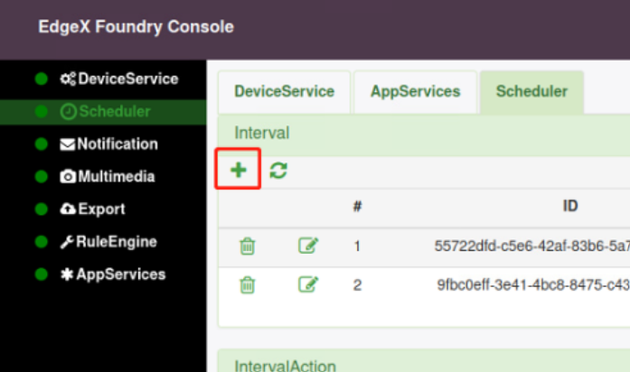 
4. Enter a rule name and set **Frequency**, for example, 10 seconds to run the task every 10 seconds. 
   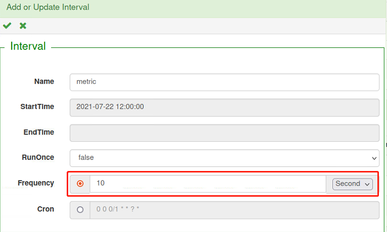 
   Click the check mark in the upper-left corner to save. The new interval appears in the list. 
   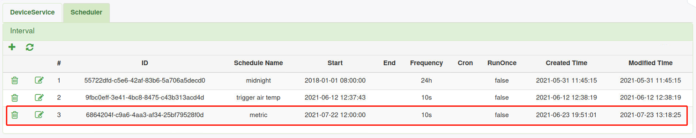 
5. Click the plus sign under **IntervalAction** to add a task trigger rule. 
   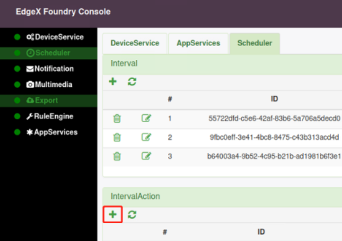 
6. Enter the rule parameters:
   - **Name**: Rule name, for example, `cpuMetric`.
   - **Interval**: The task interval; you can select the `metric` interval created earlier.
   - **Target**: Select `core-command`.
   - **TargetAction**: Select the operation to run, for example, `metric cpuInfo(get)` to query CPU information. 
   Leave the other parameters at their defaults. 
   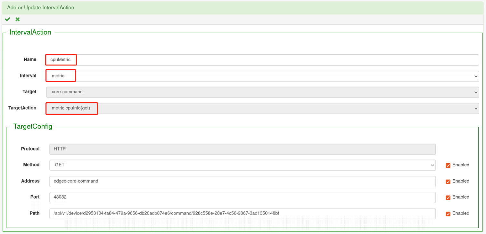 
   Click the check mark in the upper-left corner to save.
7. Repeat steps 5–6 to add scheduled queries for host, memory, and disk information. The new trigger rules appear in the list. 
   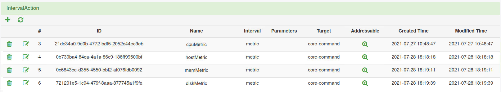 

### 3. Configure Data Export
1. Open `http://{EdgeX Foundry server IP address}:4000/` in a browser and sign in.
2. Select **AppServices** in the left navigation pane, then select the **AppServices** tab on the right.
3. Select `AppService-rules-engine` from the **AppServices** list. 
   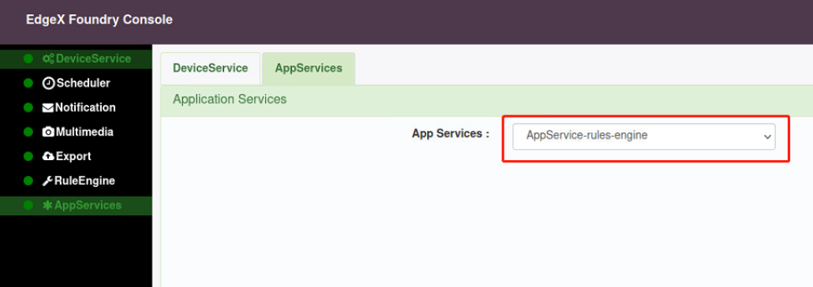 
4. In the right pane, under **Filtering**, select **FilterByDeviceName**. 
   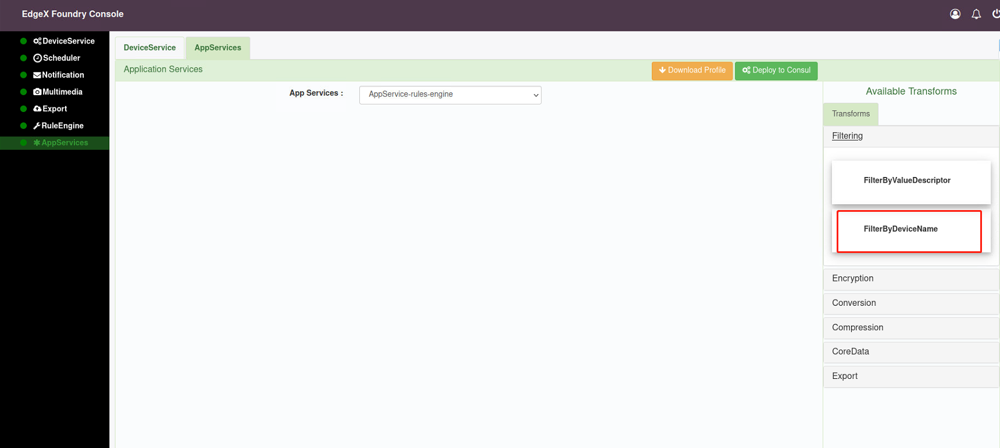 
   **FilterByDeviceName** appears in the center of the window. 
   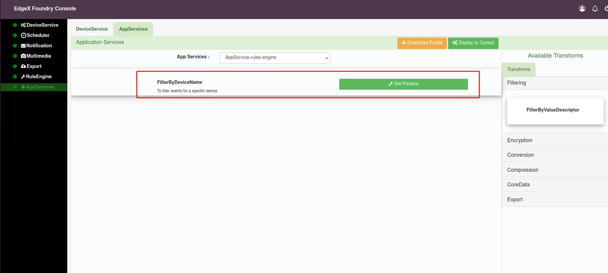 
5. Click **Set Params** next to **FilterByDeviceName**. In the **Parameters** dialog, select the device to filter; this example uses `metric` (the host device). 
   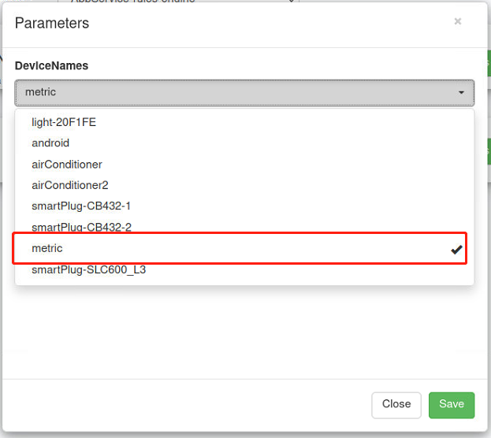 
6. Under **Export** in the right pane, select **MQTTSend**. It appears in the center of the window. 
   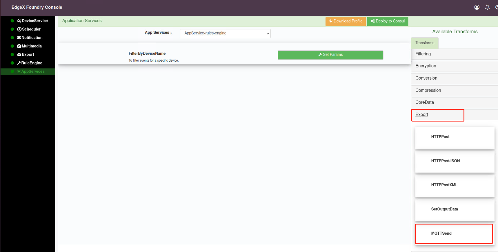 
7. Click **Set Params** next to **MQTTSend** and enter the MQTT broker details for the export destination. Set **Topic** to the destination topic. 
   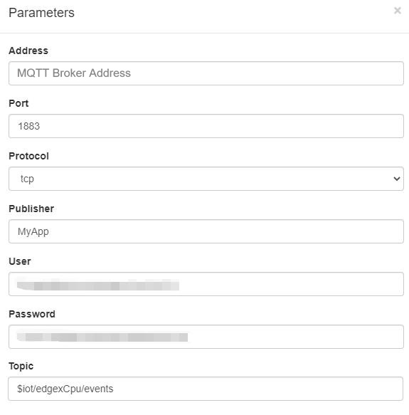 
8. Click **Deploy to Consul** to apply the configuration. All data from the host device (`metric`) is then sent to the specified topic. 
   
9. Sign in to the EdgeX Foundry server and run the following command to receive the exported data: 
   `mosquitto_sub -h {MQTT broker address} -t {Topic}` 
   Replace `{MQTT broker address}` and `{Topic}` with the values configured in step 7. 
   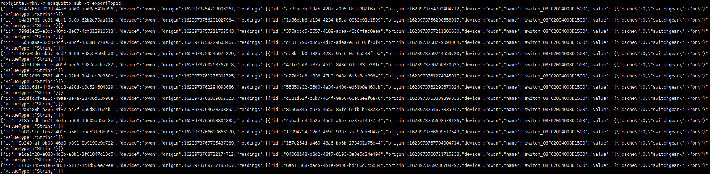

## 4. Device Auto-Discovery and Registration

This section explains how to configure EdgeX Foundry to periodically discover and
automatically register connected devices, allowing device information to be updated
at scheduled intervals.

### 4.1 Prerequisites
- EdgeX Foundry is deployed. See [EdgeX Foundry Software Deployment](1.%20EdgeX%20Foundry%20Software%20Deployment.md).
- Your computer is connected to the local network containing the EdgeX Foundry server.
- You have credentials for the EdgeX Foundry Console.

### 4.2 Configure Device Auto-Discovery and Registration
1. Sign in to the EdgeX Foundry server and check that the `autoregister` service is running:
   `docker-compose ps` 
   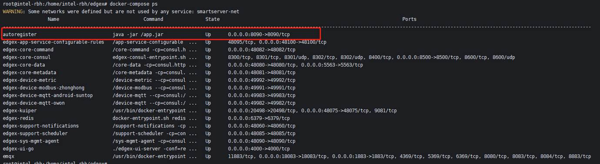 
2. Configure the device auto-discovery registration task. 
   (1) In EdgeX Foundry Console, add a scheduled task using steps 1–4 in [Configure Scheduled Host Status Reporting](#2-configure-scheduled-host-status-reporting). Name the task and set its **Frequency** based on your environment. The source guide recommends 30 minutes, though its explanation says the task runs every 30 seconds; confirm the intended interval in your deployment before applying it. 
      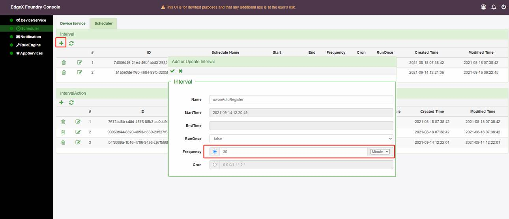 
   (2) Click the plus sign under **IntervalAction** to add a trigger rule.
       
   (3) Set the parameters:
      - **Name**: for example, `owonRegister`
      - **Interval**: Select the interval created above.
      - **Target**: `core-command`
      - **TargetAction**: `owon listAllDev(get)`
      - Leave the remaining options at their defaults.
      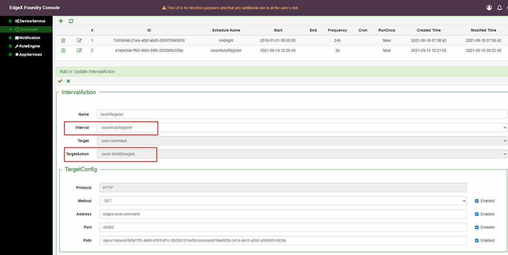 
3. Configure a data export task for discovered devices. 
   (1) Select `AppService-rules-engine` in **AppServices**, following steps 1–4 in [Configure Data Export](#3-configure-data-export).
   (2) Set **FilterByDeviceName** to `owon` (the devices connected to OWON), then save.
      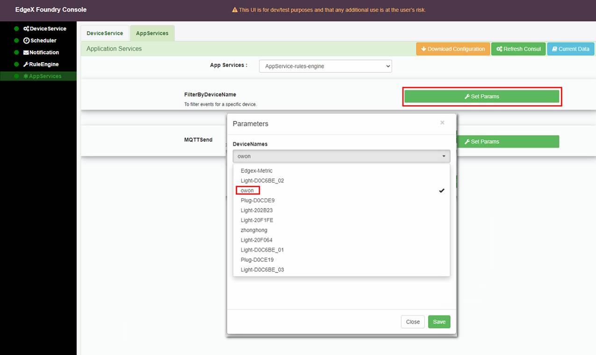 

   (3) Configure the MQTT export parameters. Set **Topic** to the desired destination topic and leave other parameters at their defaults. All real-time messages are published to this topic.
      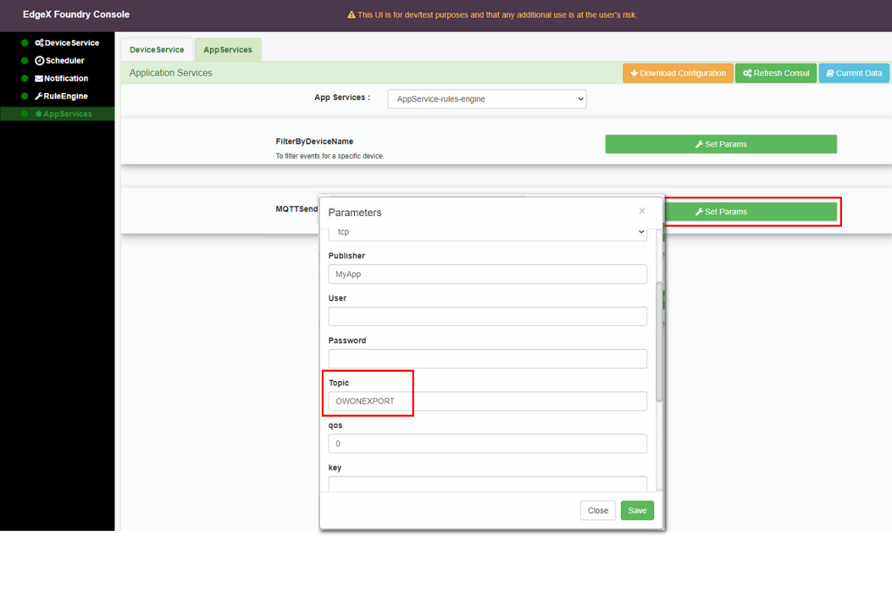
       
   (4) Click **Deploy to Consul** to apply the configuration.
      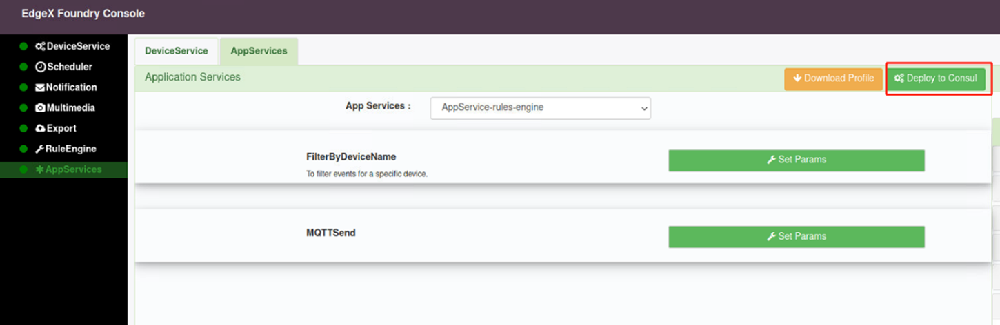      
       
   (5) In `docker-compose.yml`, update `OWONEXPORTTOPIC` to the topic configured above.
      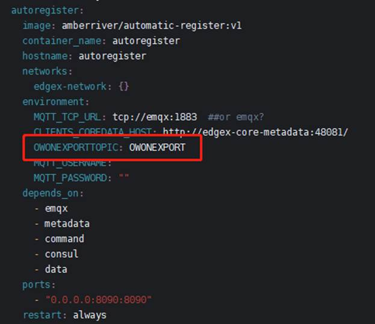      
       
   (6) Restart the AutoRegister service:
      `docker-compose restart autoregister`
      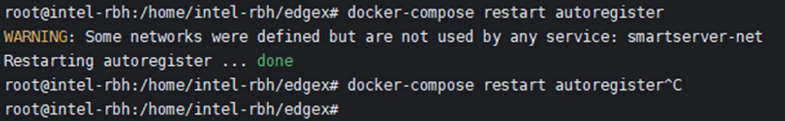 

### 4.3 Receive Real-Time OWON Device Messages
1. Complete Section 4.2, Step 3, Substeps (1)–(4) to configure the device discovery data
export task.
2. On the EdgeX Foundry server, subscribe to the configured topic:
   `mosquitto_sub -h {MQTT broker address} -t {Topic}`
   Replace the placeholders with the values configured for the export task.

Example message:
`{"id":"cd7a067b-b8b7-4952-9792-36c0b39c9960","device":"owon","created":1631764745332,"origin":1631764745332365068,"readings":[{"id":"55a85581-c7ef-4839-914f-b1d32c3216b8","origin":1631764745332223143,"device":"owon","name":"realtimeData","value":"{\"argument\":{\"activePower\":0,\"demandFormatting\":0,\"divisor\":1000,\"ep\":1,\"ieee\":\"E9CDD0FEFF2C6A3C\",\"meteringDeviceStatus\":0,\"mutiplier\":1,\"summation\":0,\"summationFormatting\":0,\"unitOfMeasure\":0},\"command\":\"energy\",\"type\":\"update\"}","valueType":"String"}]}`

### 4.4 Receive Real-Time ZhongHong TCP Messages
1. In a browser, open `http://{EdgeX Foundry IP address}:8500/ui/dc1/kv/edgex/devices/1.0/edgex-device-modbus-zhonghong/Driver`. 
   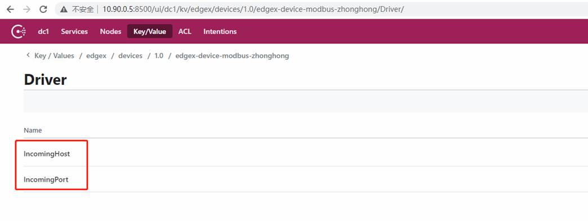
   
    
2. Set `IncomingHost` to the ZhongHong gateway IP address. 
   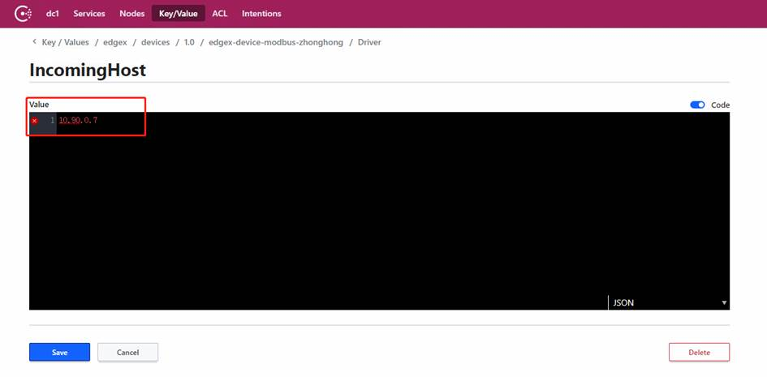
   
    
3. In the ZhongHong Modbus gateway management page, find its local TCP port. 
   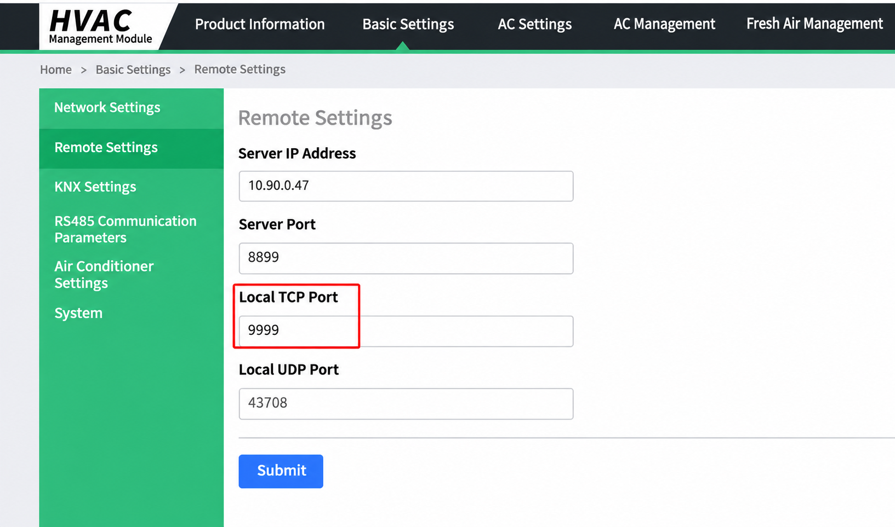
   
    
4. Set `IncomingPort` to that local TCP port. 
   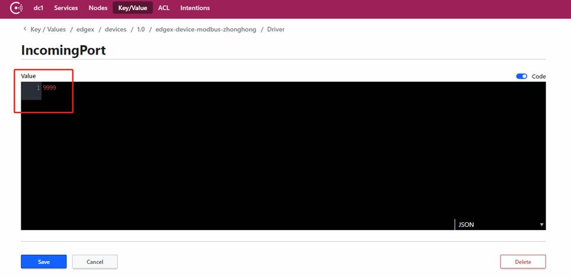
   
    
5. Restart the ZhongHong service:
   `docker restart edgex-device-modbus-zhonghong`
6. In **AppServices**, add `zhonghong` to **FilterByDeviceName** and configure MQTT export as described above. 
   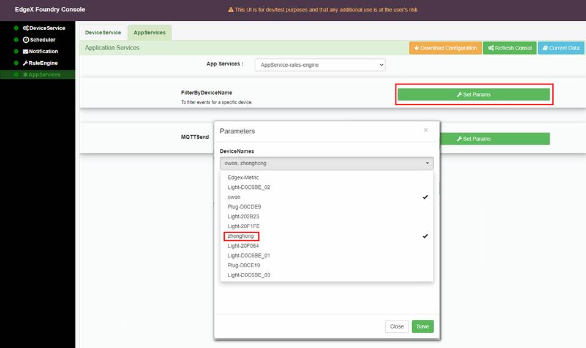 
   
   
    
7. Subscribe to the configured topic on the EdgeX Foundry server:
   `mosquitto_sub -h {MQTT broker address} -t {Topic}`

Example message:
`{"id":"2fcdd038-0601-4483-8502-7a0e993db745","device":"zhonghong","created":1631764525193,"origin":1631764525193401956,"readings":[{"id":"3d5bfb3c-ef16-47ed-a0da-9690d3278c80","origin":1631764525193366385,"device":"zhonghong","name":"realtimeData","value":"{\"connectionInfo\":{\"Address\":\"10.90.0.7\",\"Port\":9999},\"response\":\"015001010103001a04041800000091\"}","valueType":"String"}]}`

